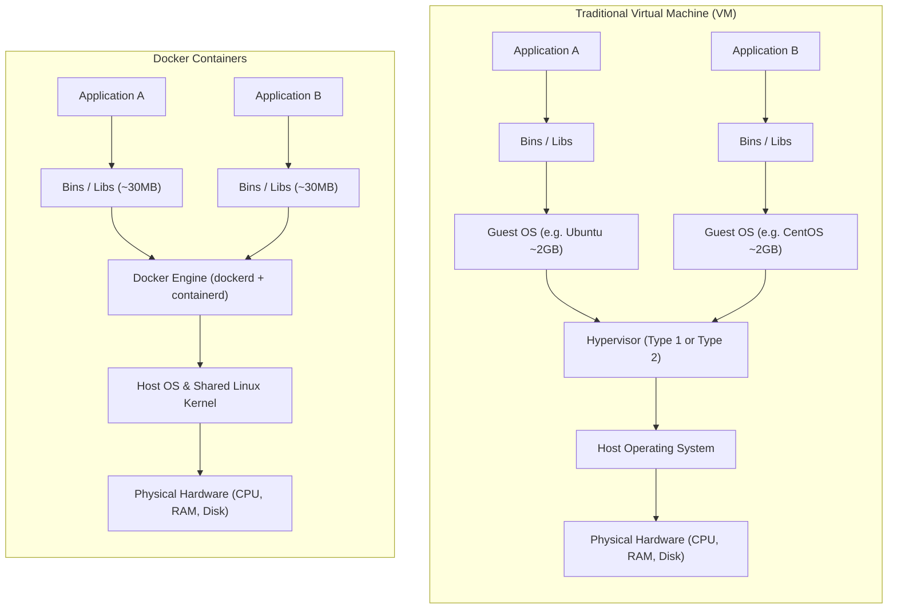
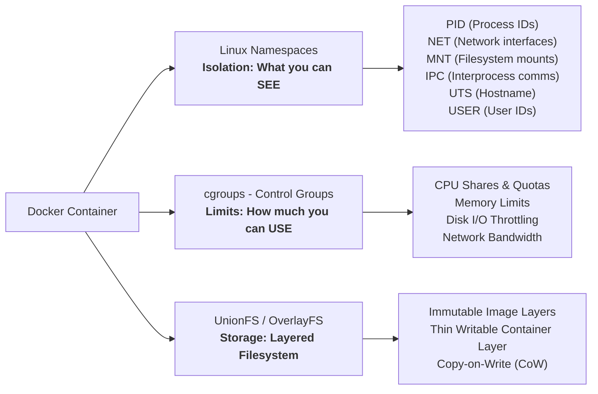
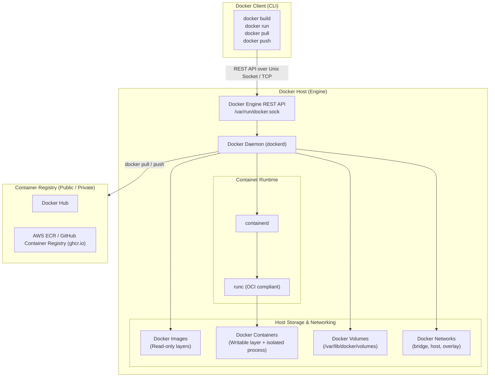
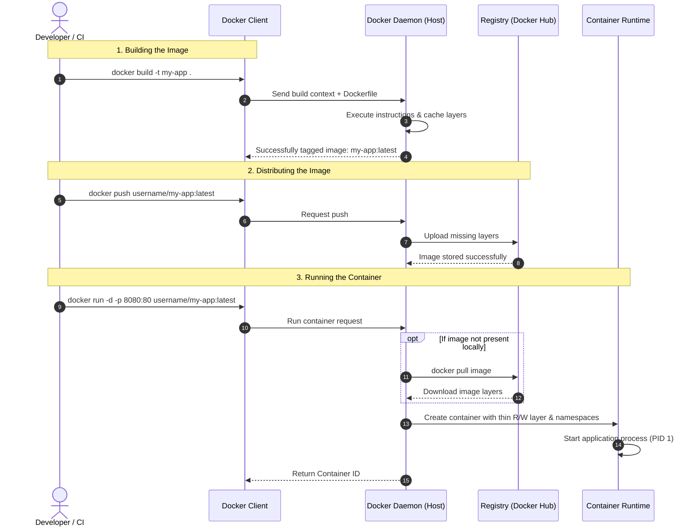

# 🐳 Docker Zero to Hero: Complete Guide & Practice


> **Welcome to Docker Practice!** 🚀  
> This repository is a comprehensive, beginner-friendly, and practical guide designed to help you master Docker from fundamentals to production-ready workflows. If you find this guide useful, don't forget to **⭐ Star** this repository!


## 1. What is a Container?

### The Real-World Analogy
Before standard shipping containers were invented in the 1950s, cargo transport was chaotic. Barrels, sacks, crates, and loose machinery were loaded individually onto ships, causing delays, damage, and incompatibilities between trains, trucks, and boats. The **standard intermodal shipping container** revolutionized logistics: any cargo can go inside, and any crane, ship, or truck can transport it anywhere without worrying about what is inside.

**Software containers do the exact same thing for code.**

### Technical Definition
A **container** is a lightweight, standalone, executable package that bundles:
1. **Application Code**
2. **Runtime Engine** (e.g., Python, Node.js, Java, .NET)
3. **Application Libraries & Dependencies** (e.g., pip packages, npm modules)
4. **Minimal OS Root Filesystem & System Libraries** (`/bin`, `/lib`, `/etc`)
5. **Default Configuration & Environment Variables**

It packages everything required to run your application reliably and identically across **any** computing environment—whether on your local laptop, a colleague’s workstation, a staging server, or an AWS/GCP cloud cluster.

> [!TIP]
> **One-liner summary:**  
> A container = Your Application + Its Libraries + Minimal System Dependencies, isolated and running directly on the host operating system kernel.

---

## 2. Containers vs. Virtual Machines (VMs)

### Architecture Comparison



### Comparison Matrix

| Feature | Virtual Machines (VMs) | Docker Containers |
| :--- | :--- | :--- |
| **Architecture** | Emulates entire physical hardware + runs full guest OS | Shares the host OS kernel via isolation primitives |
| **Size** | Gigabytes (GBs) per VM (typically 2GB - 20GB+) | Megabytes (MBs) per image (often 10MB - 200MB) |
| **Startup Time** | Minutes (boots full OS kernel, systemd services) | Milliseconds to seconds (starts as an isolated process) |
| **Resource Usage** | Heavy (pre-allocates CPU, RAM, and storage) | Lightweight (uses only what the application actively consumes) |
| **Portability** | Harder to move (huge images, hypervisor dependent) | Extremely portable (runs anywhere Docker is installed) |
| **Isolation** | Hardware-level isolation (stronger boundary) | Process-level isolation via kernel namespaces (very safe) |
| **Density** | Can run 10s of VMs per host | Can run 100s to 1,000s of containers per host |

---

### Why Are Containers So Lightweight?

A container image does **not** contain an operating system kernel, bootloader, or hardware drivers. It relies directly on the **Host OS Kernel**.

- **Ubuntu VM Image:** ~2.3 GB (includes full kernel, boot system, device drivers, system utilities, desktop/server packages).
- **Ubuntu Docker Container Base Image:** ~28 MB to ~70 MB (contains only user-space binaries and shared libraries).
- **Alpine Linux Container Base Image:** ~5 MB!

#### What is inside a Container Base Image?
A container root filesystem contains only basic user-space directories:
- `/bin`: Minimal executable binaries (`ls`, `cp`, `sh`, `cat`).
- `/etc`: Configuration files for services.
- `/lib` & `/usr/lib`: Shared C libraries (`glibc`, `musl`) needed by binaries.
- `/usr`: User utilities, compilers, runtime engines.
- `/var`: Log files and runtime temporary data.

#### What does the Container borrow from the Host OS?
- **Linux Kernel:** Handles system calls, CPU/memory scheduling, and device I/O.
- **Networking Stack:** Host networking interface, iptables, routing.
- **Storage Subsystem:** Mount points, bind mounts, and Union File Systems.

---

### Linux Primitives Powering Containers

Docker didn't invent containerization from scratch; it made underlying Linux kernel features easy to use through high-level tooling:



1. **Namespaces (Isolation - "What the container can see"):**
   - **PID:** Gives the container its own process tree (the app runs as PID 1 inside the container).
   - **NET:** Gives the container its own virtual network interface, IP address, and routing table.
   - **MNT:** Gives the container its own isolated filesystem mount points.
   - **UTS:** Gives the container its own independent hostname.
   - **IPC:** Isolates inter-process communication resources.
   - **USER:** Maps in-container users to host users.

2. **cgroups / Control Groups (Resource Limits - "What the container can use"):**
   - Enforces hardware limits so a single container cannot exhaust all CPU or RAM on the host machine.
   - Example: Restricting a container to max 512MB RAM and 1 CPU core (`--memory="512m" --cpus="1.0"`).

3. **OverlayFS / Union File System (Layered Storage):**
   - Allows multiple read-only filesystem layers to be merged into a single unified view with a thin writable layer on top.

---

## 3. Why is Docker Useful?

| Problem Before Docker | How Docker Solves It |
| :--- | :--- |
| **"It works on my machine!"** | Bundles application code, runtime version, and system dependencies together so behavior is 100% identical on every machine. |
| **Dependency Conflicts & Hell** | Run Python 2.7, Python 3.9, Python 3.12, Node 16, and Node 20 on the same machine without colliding libraries. |
| **Slow Developer Onboarding** | Instead of a 20-page setup doc taking 3 days, a new dev runs `docker compose up` and is productive in 5 minutes. |
| **Heavy Resource Inefficiency** | Pack dozens of isolated microservices onto one server without paying the overhead of multiple full guest OS instances. |
| **Complex CI/CD Pipelines** | Test in the exact same container image that will be deployed to production, eliminating environment drift. |
| **Microservices Architecture** | Easily spin up, scale, update, and network microservices (web app, Redis cache, Postgres database, message broker). |

---

## 4. Docker Architecture & Core Components

Docker uses a **client-server architecture**. The Docker client communicates with the Docker daemon, which does the heavy lifting of building, running, and distributing your containers.

### Architecture Diagram



### Core Components Breakdown

1. **Docker Client (`docker`)**
   - The primary command-line interface (CLI) used by developers.
   - When you type `docker run`, the client packages your request into REST API calls and sends them to the daemon.
   - The client can connect to a local daemon or a remote Docker host across the network.

2. **Docker Daemon (`dockerd`)**
   - The persistent background service running on the host OS.
   - **Brain of Docker:** Listens for API requests and manages Docker objects: images, containers, networks, and volumes.
   - Coordinates with `containerd` to manage container execution.

3. **Container Runtime (`containerd` & `runc`)**
   - **`containerd`:** An industry-standard container runtime that manages the complete container lifecycle (pulling images, supervising execution, storage, network attachments).
   - **`runc`:** A lightweight, Open Container Initiative (OCI) compliant tool used by containerd to actually spawn and run containers using Linux namespaces and cgroups.

4. **Docker Images**
   - Read-only, immutable templates composed of stacked layers.
   - Created from instructions written in a `Dockerfile`.
   - Cannot be modified once built—any update produces a new layer or image.

5. **Docker Containers**
   - An active, running, or stopped instance of a Docker image.
   - Consists of the read-only image layers plus a thin, top **writable container layer** (Read/Write).

6. **Docker Registries**
   - Central repositories where Docker images are uploaded, stored, versioned, and shared.
   - **Docker Hub** is the default public registry.
   - Organizations often use private registries like AWS ECR, Google Artifact Registry, Azure ACR, Quay.io, or Harbor.

7. **Docker Volumes & Bind Mounts**
   - By default, data inside a container is **ephemeral** (lost when the container is deleted).
   - **Volumes** (`/var/lib/docker/volumes`) and **Bind Mounts** (mounting a host directory into a container) provide persistent and shared storage across container lifecycles.

8. **Docker Networks**
   - Enables communication between containers and external networks.
   - Built-in drivers include:
     - `bridge`: Default network for standalone containers on the same host.
     - `host`: Removes network isolation; container shares host’s network stack directly.
     - `overlay`: Enables multi-host communication (used in Docker Swarm & Kubernetes).
     - `none`: Completely disables networking for air-gapped security.

---

## 5. How Docker Works: The Lifecycle

### Lifecycle Workflow



### How Image Layers and Copy-on-Write Work

Every line in a `Dockerfile` creates a **read-only layer**. When you start a container, Docker adds a thin **writable layer** on top:

```
┌────────────────────────────────────────────────────────┐
│  Writable Container Layer (Read / Write)               │  <-- Created on 'docker run' (temporary data)
├────────────────────────────────────────────────────────┤
│  Layer 4: CMD ["python3", "app.py"]                    │  <-- Read-only image layer
├────────────────────────────────────────────────────────┤
│  Layer 3: COPY . /app                                  │  <-- Read-only image layer
├────────────────────────────────────────────────────────┤
│  Layer 2: RUN apt-get update && apt-get install python3│  <-- Read-only image layer
├────────────────────────────────────────────────────────┤
│  Layer 1: FROM ubuntu:22.04                            │  <-- Read-only base layer
└────────────────────────────────────────────────────────┘
```

- **Layer Caching:** If your code changes in Layer 3 (`COPY . /app`), Docker reuses cached layers 1 and 2, rebuilding only from Layer 3 downwards. Builds take seconds instead of minutes!
- **Copy-on-Write (CoW):** If a container modifies an existing file from a lower layer, Docker copies the file up to the top writable layer before editing. The original base image remains completely untouched.

---

## 6. Installation & Post-Install Setup

### Linux (Ubuntu / Debian)

Install the official Docker Engine using the convenience script or apt repository:

```bash
# 1. Update package index
sudo apt update && sudo apt install -y curl ca-certificates gnupg

# 2. Install Docker
sudo apt install -y docker.io

# 3. Verify Docker service status
sudo systemctl status docker
```

---

### macOS & Windows

- **macOS:** Download and install [Docker Desktop for Mac](https://docs.docker.com/desktop/setup/install/mac-install/) (Apple Silicon or Intel) or use lightweight alternatives like `colima` (`brew install colima docker`).
- **Windows:** Download and install [Docker Desktop for Windows](https://docs.docker.com/desktop/setup/install/windows-install/) with the **WSL2 (Windows Subsystem for Linux)** backend enabled.

---

### Critical Post-Install: Fixing Permission Denied

A very common issue on Linux after installation is:

```text
docker: Got permission denied while trying to connect to the Docker daemon socket at unix:///var/run/docker.sock
```

#### Why does this happen?
The Docker daemon runs as the `root` user and listens on a Unix domain socket owned by the `docker` group. If your current user is not in the `docker` group, you will get a permission denied error.

#### The Fix:
```bash
# 1. Ensure the docker service is active and running
sudo systemctl enable --now docker

# 2. Add your current user to the 'docker' group
sudo usermod -aG docker $USER

# 3. Apply the new group membership immediately (or log out and log back in)
newgrp docker

# 4. Test without sudo
docker run hello-world
```

---

## 7. Hands-on Tutorial: From Zero to Running App

Let's walk through building, running, and publishing a real container step by step.

### Step 1: Verify Installation
```bash
docker run hello-world
```
If you see `Hello from Docker! This message shows that your installation appears to be working correctly.`, your setup is solid!

---

### Step 2: Understand the Dockerfile

You can use the ready-made code in [`examples/python-web-app`](./examples/python-web-app) or create it yourself:

```bash
cd examples/python-web-app
```

#### `app.py`
```python
from http.server import SimpleHTTPRequestHandler, HTTPServer
import os

PORT = int(os.environ.get("PORT", 8080))

class Handler(SimpleHTTPRequestHandler):
    def do_GET(self):
        self.send_response(200)
        self.send_header("Content-type", "text/html; charset=utf-8")
        self.end_headers()
        html = f"""
        <html>
            <body style='font-family: Arial; text-align: center; padding-top: 50px;'>
                <h1>🐳 Hello from Docker Container!</h1>
                <p>Welcome to <b>DockerPractice</b>.</p>
                <p>Environment: <b>{os.environ.get('ENVIRONMENT', 'Production')}</b></p>
            </body>
        </html>
        """
        self.wfile.write(html.encode("utf-8"))

if __name__ == "__main__":
    print(f"Server starting on port {PORT}...")
    server = HTTPServer(("0.0.0.0", PORT), Handler)
    server.serve_forever()
```

#### `Dockerfile`
```dockerfile
# 1. Base Image: Use an official lightweight Python runtime
FROM python:3.11-slim

# 2. Working Directory: Set the working directory inside the container
WORKDIR /app

# 3. Environment Variables: Set defaults
ENV PORT=8080
ENV ENVIRONMENT=Practice

# 4. Copy Code: Copy current directory contents into /app
COPY app.py .

# 5. Expose Port: Document the port the container listens on
EXPOSE 8080

# 6. Command: Specify the default command executed when container starts
CMD ["python", "app.py"]
```

#### Dockerfile Directives Explained:
- `FROM`: Sets the foundational image (always the first line).
- `WORKDIR`: Sets the working directory for all subsequent instructions (`RUN`, `COPY`, `CMD`).
- `COPY`: Copies files from host machine into container filesystem.
- `RUN`: Executes commands during image **build time** (e.g., `apt install`, `pip install`).
- `ENV`: Defines environment variables accessible during build and runtime.
- `EXPOSE`: Documents which network ports the application listens to (informational).
- `CMD`: Specifies the default command to execute when the container **runs** (can be overridden from CLI).
- `ENTRYPOINT`: Specifies the fixed executable to run (arguments can be passed to it).

---

### Step 3: Build Your Docker Image

Run the build command inside the directory with your `Dockerfile`:

```bash
docker build -t my-python-app:1.0 .
```

- `-t my-python-app:1.0`: Tags your image with a readable name and version tag.
- `.`: The build context (Docker packages files in this directory and sends them to the daemon).

Verify the image exists:
```bash
docker images
```

---

### Step 4: Run Your Container

Launch your container in detached mode with port forwarding:

```bash
docker run -d -p 8080:8080 --name my-running-app my-python-app:1.0
```

#### Breakdown of flags:
- `-d`: **Detached mode** (runs container in the background, freeing your terminal).
- `-p 8080:8080`: **Port publishing** (`<host-port>:<container-port>`). Forwards traffic hitting port 8080 on your host to port 8080 inside the container.
- `--name my-running-app`: Assigns a friendly name instead of a random generated one.

Now open your browser or run:
```bash
curl http://localhost:8080
```

---

### Step 5: Inspect and Debug

```bash
# 1. List running containers
docker ps

# 2. View container logs in real time
docker logs -f my-running-app

# 3. Open an interactive shell inside the running container
docker exec -it my-running-app /bin/sh

# 4. Check resource usage statistics (CPU, RAM, I/O)
docker stats my-running-app

# 5. Stop the container
docker stop my-running-app

# 6. Delete the container
docker rm my-running-app
```

---

### Step 6: Push to Docker Hub

Share your image with the world or deploy it to a cloud server:

```bash
# 1. Log in to your Docker Hub account
docker login

# 2. Tag your image with your Docker Hub username
docker tag my-python-app:1.0 <your-dockerhub-username>/my-python-app:1.0

# 3. Push the image layers to Docker Hub
docker push <your-dockerhub-username>/my-python-app:1.0
```

Anyone anywhere can now run your app with:
```bash
docker run -p 8080:8080 <your-dockerhub-username>/my-python-app:1.0
```

---

## 8. Essential Docker Commands Cheat Sheet

### 📦 Container Lifecycle
| Command | Description |
| :--- | :--- |
| `docker run -d -p 80:80 <image>` | Create and start a container in detached mode with port forwarding |
| `docker run -it <image> /bin/bash` | Run container interactively with a bash shell |
| `docker ps` | List all currently running containers |
| `docker ps -a` | List all containers (running + stopped) |
| `docker stop <id/name>` | Gracefully stop a running container (`SIGTERM`) |
| `docker start <id/name>` | Start a stopped container |
| `docker restart <id/name>` | Restart a running container |
| `docker rm <id/name>` | Remove a stopped container |
| `docker rm -f <id/name>` | Force-remove a running container (`SIGKILL`) |

### 🖼️ Image Management
| Command | Description |
| :--- | :--- |
| `docker build -t <name>:<tag> .` | Build an image from a `Dockerfile` |
| `docker images` | List all images available locally on the host |
| `docker pull <image>:<tag>` | Pull an image from Docker Hub / registry |
| `docker push <image>:<tag>` | Push an image to Docker Hub / registry |
| `docker rmi <image>` | Remove an image from local storage |
| `docker tag <source> <target>` | Create a new tag pointing to an existing image |

### 🔍 Debugging & Logs
| Command | Description |
| :--- | :--- |
| `docker logs -f <container>` | Stream container stdout/stderr output in real-time |
| `docker exec -it <container> sh` | Open a terminal shell inside a running container |
| `docker inspect <container/image>` | View detailed low-level JSON configuration (IP, ports, mounts) |
| `docker top <container>` | Display running processes inside a container |
| `docker stats` | Live stream of CPU, memory, network, and disk I/O metrics |

### 🧹 Cleanup & Pruning
| Command | Description |
| :--- | :--- |
| `docker container prune -f` | Remove all stopped containers |
| `docker image prune -f` | Remove all dangling (untagged) images |
| `docker volume prune -f` | Remove all unused local volumes |
| `docker system prune -a --volumes` | **Nuke option:** Remove all stopped containers, unused networks, unused images, and unused volumes |

---

## 9. Docker Best Practices

1. **Use Minimal Base Images:**  
   Prefer `alpine`, `slim`, or Google `distroless` images instead of full OS images (e.g. `python:3.11-slim` instead of `python:3.11`). Smaller images = faster pulls, lower storage, and drastically smaller attack surface.

2. **Order Dockerfile Instructions for Efficient Caching:**  
   Place instructions that change infrequently (installing dependencies) before instructions that change often (copying source code).
   ```dockerfile
   # Good caching pattern:
   COPY requirements.txt .
   RUN pip install --no-cache-dir -r requirements.txt
   COPY . .
   ```

3. **Use `.dockerignore`:**  
   Always add a `.dockerignore` file in your build root to exclude `.git`, `node_modules`, `__pycache__`, local `.env` secrets, and temporary files from bloating the build context.

4. **Never Run as `root` in Production:**  
   Create and switch to a non-privileged user inside your container to limit privilege escalation attacks:
   ```dockerfile
   RUN useradd -u 8888 appuser
   USER appuser
   ```

5. **Use Multi-Stage Builds:**  
   Compile in a heavy build stage, then copy only the compiled binary into a tiny production runtime stage:
   ```dockerfile
   # Stage 1: Build
   FROM golang:1.21 AS builder
   WORKDIR /app
   COPY . .
   RUN CGO_ENABLED=0 go build -o server .

   # Stage 2: Minimal Runtime
   FROM alpine:latest
   WORKDIR /app
   COPY --from=builder /app/server .
   EXPOSE 8080
   CMD ["./server"]
   ```

---

## 10. Contributing & Community

Contributions are what make the open-source community an amazing place to learn, inspire, and create!

1. Fork the Project
2. Create your Feature Branch (`git checkout -b feature/NewDockerExample`)
3. Commit your Changes (`git commit -m 'Add practical Docker Compose example'`)
4. Push to the Branch (`git push origin feature/NewDockerExample`)
5. Open a Pull Request

⭐ **If you found this guide helpful, please star this repository!**
