# 🏛️ Docker Fundamentals: Complete Docker Architecture Guide

Welcome to Day 1 of your Docker journey! This guide covers the **Docker architecture, internal components, and runtime mechanics** in deep, beginner-friendly detail. By the end of this guide, you will understand how the Docker client, daemon, API, container runtimes (`containerd`, `runc`), storage layers, networking, and platform-specific implementations (such as Docker Desktop on macOS) work together to deliver blazing-fast application isolation.

---

## 📑 Table of Contents
1. [Introduction to Docker Architecture](#1-introduction-to-docker-architecture)
2. [Deep Dive: The 11 Core Docker Architecture Components](#2-deep-dive-the-11-core-docker-architecture-components)
   - [1. Docker Client (CLI)](#1-docker-client-cli)
   - [2. Docker Daemon (`dockerd`)](#2-docker-daemon-dockerd)
   - [3. Docker Engine](#3-docker-engine)
   - [4. Docker REST API & Sockets](#4-docker-rest-api--sockets)
   - [5. Docker Registry & Repositories](#5-docker-registry--repositories)
   - [6. Docker Images & Layered Storage](#6-docker-images--layered-storage)
   - [7. Docker Containers & Namespaces/Cgroups](#7-docker-containers--namespaces--cgroups)
   - [8. Container Runtime (`containerd` & `runc`)](#8-container-runtime-containerd--runc)
   - [9. Docker Networking Subsystem](#9-docker-networking-subsystem)
   - [10. Docker Storage Subsystem (Volumes & Bind Mounts)](#10-docker-storage-subsystem-volumes--bind-mounts)
   - [11. Docker Desktop on macOS (Hypervisor & Linux VM)](#11-docker-desktop-on-macos)
3. [How Docker Works: End-to-End Workflow](#3-how-docker-works-end-to-end-workflow)
4. [Docker Architecture vs. Virtual Machine Architecture](#4-docker-architecture-vs-virtual-machine-architecture)
5. [Important Docker Commands by Architecture Component](#5-important-docker-commands-by-architecture-component)
6. [Practical Architecture Example: Mac to Running Web App](#6-practical-architecture-example-mac-to-running-web-app)
7. [Architecture Troubleshooting & Security Best Practices](#7-architecture-troubleshooting--security-best-practices)
8. [Summary, Interview Questions & Architecture Checklist](#8-summary-interview-questions--architecture-checklist)

---

## 1. Introduction to Docker Architecture

### What is Docker Architecture?
**Docker architecture** refers to the internal system design, separation of concerns, and structural components that enable Docker to build, distribute, run, and manage isolated software containers.

Docker is designed around a **decoupled, modular Client-Server Architecture**:
- The **Client** (what you interact with) is a thin command-line interface or graphical app.
- The **Server** (the engine and daemon) does the heavy lifting of building, pulling, running, and managing containers.
- They communicate asynchronously over an open, standardized **REST API**.

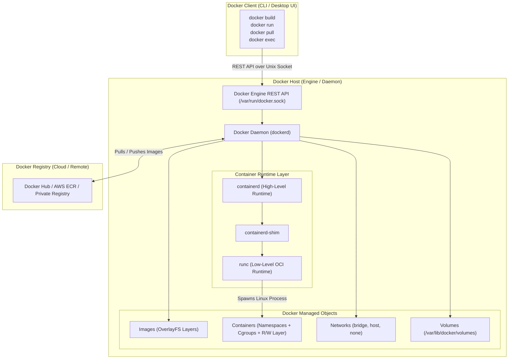

### Why Docker Uses a Client-Server Architecture
1. **Separation of Concerns**: The CLI only formats user commands; the daemon manages system resources, kernel primitives, and storage drivers.
2. **Remote Management**: Because the interface is an HTTP REST API, a single Docker client on your MacBook or laptop can seamlessly manage a Docker daemon running on a remote Linux server across the world by simply setting the `DOCKER_HOST` environment variable.
3. **Multi-Platform Support**: macOS and Windows do not have native Linux kernels. A client-server model allows the macOS CLI to speak seamlessly to a Linux daemon running inside a lightweight virtual machine.

### Docker Architecture vs. Docker Lifecycle
A common point of confusion for beginners is the difference between architecture and lifecycle:
- **Docker Architecture** describes **WHAT** the system components are and **HOW** they are wired together (Client, Daemon, REST API, `containerd`, `runc`, Namespaces, OverlayFS).
- **Docker Lifecycle** describes **WHEN** and in what sequence containers and images transition through states (Created $\rightarrow$ Running $\rightarrow$ Paused $\rightarrow$ Stopped $\rightarrow$ Removed).

---

## 2. Deep Dive: The 11 Core Docker Architecture Components

---

### 1. Docker Client (CLI)

#### What It Is
The Docker Client is the primary interface through which developers and operators interact with Docker. When you open your terminal and type `docker run` or `docker build`, you are executing the `docker` binary (CLI).

#### How It Works Internally
The client is **stateless and does not execute containers itself**:
1. It parses your command-line arguments and flags (e.g., `-d`, `-p 8081:80`).
2. It translates the command into a standard HTTP REST API request (e.g., `POST /containers/create` followed by `POST /containers/{id}/start`).
3. It opens an IPC connection to the Docker daemon via a Unix Domain Socket (`/var/run/docker.sock`) or a remote network socket (`tcp://<host>:2376`).
4. It waits for the daemon's response, formats the JSON payload into human-readable tables or logs, and displays it in your terminal.

#### Examples of Client Translation:
- `docker pull nginx:alpine` $\longrightarrow$ `POST /images/create?fromImage=nginx&tag=alpine`
- `docker ps` $\longrightarrow$ `GET /containers/json`
- `docker stop myapp` $\longrightarrow$ `POST /containers/myapp/stop`

---

### 2. Docker Daemon (`dockerd`)

#### What It Is
The Docker daemon (`dockerd`) is a persistent background service running on the host operating system. It represents the "server" in Docker's client-server model.

#### Core Responsibilities
- **API Server**: Listens continuously for Docker REST API calls from the client.
- **Image Management**: Coordinates image layer downloads, hashing, decompression, and local caching.
- **Container Lifecycle Coordination**: Coordinates container creation, state changes, and monitoring by delegating to `containerd`.
- **Network Management**: Creates virtual bridges, configures `iptables` / `nftables` NAT rules, and sets up virtual Ethernet pairs (`veth`).
- **Volume Management**: Provisions and mounts persistent storage volumes.
- **Security & Authorization**: Enforces access control policies and daemon configuration (`/etc/docker/daemon.json`).

---

### 3. Docker Engine

#### What It Is
**Docker Engine** is the complete, integrated client-server technology stack that users install. Many people use the terms "Docker", "Docker Engine", and "Docker Daemon" interchangeably, but technically:

$$\text{Docker Engine} = \text{Docker CLI} + \text{Docker REST API} + \text{dockerd} + \text{containerd} + \text{runc} + \text{Plugins}$$

- `dockerd` is just the single background process.
- **Docker Engine** is the full product package containing the daemon, CLI tools, runtime orchestration, network drivers, and storage plugins.

---

### 4. Docker REST API & Sockets

#### How Client and Daemon Communicate
The Docker Client and Daemon communicate using an HTTP/1.1 REST API.

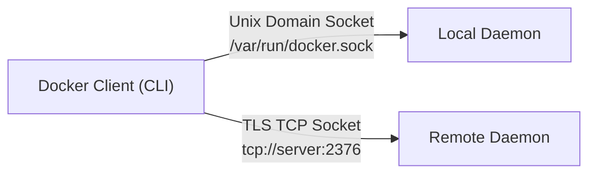

#### Communication Channels:
1. **Unix Domain Socket (Default)**:  
   Located at `unix:///var/run/docker.sock`. Used for local inter-process communication on the same machine. It is extremely fast because communication does not traverse the network stack.
2. **TCP Socket (Remote Access)**:  
   Used when controlling a remote Docker host. By default, unencrypted TCP uses port `2375`, while encrypted and authenticated mTLS uses port `2376`.

#### Testing the Docker API Directly with `curl`:
Because it is a standard REST API, you can communicate with Docker using `curl` without the Docker CLI:
```bash
# Query Docker daemon version via Unix socket
curl --unix-socket /var/run/docker.sock http://localhost/version

# List running containers via Unix socket
curl --unix-socket /var/run/docker.sock http://localhost/containers/json
```

#### Security Risks of the Docker Socket
> [!CAUTION]
> Anyone who has read/write access to `/var/run/docker.sock` has **root-equivalent privileges** on the host operating system!  
> If an attacker gains access to the Docker socket, they can run a privileged container that mounts the entire host root directory (`docker run -v /:/host-root ...`), compromising the host machine entirely.  
> **Never** expose the Docker socket over an unencrypted TCP port (`0.0.0.0:2375`) without client certificate verification (mTLS).

---

### 5. Docker Registry & Repositories

#### Registry vs. Repository
Beginners often confuse these two terms:
- **Docker Registry**: A centralized service or server responsible for storing, versioning, and distributing Docker images (e.g., Docker Hub, AWS ECR, Google Artifact Registry, GitHub Container Registry).
- **Docker Repository**: A specific collection of related images with the same name but different tags (versions) inside a registry (e.g., `nginx`, `ubuntu`, `python`).

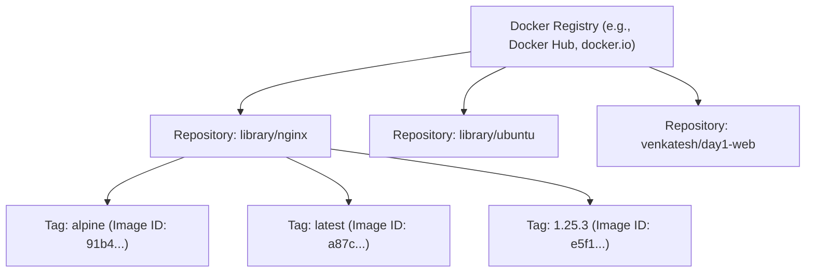

#### Public vs. Private Registries:
- **Public**: Anyone can pull images (Docker Hub official library, Quay.io).
- **Private**: Requires authentication (`docker login`) to protect proprietary enterprise code (AWS ECR, Azure ACR, Google Artifact Registry, Harbor).

#### Image Pull Mechanics:
When you run:
```bash
docker pull nginx:alpine
```
1. The client asks the daemon to fetch `nginx:alpine`.
2. The daemon resolves the full name to `docker.io/library/nginx:alpine`.
3. It contacts the Docker Hub registry and requests the image **Manifest** (a JSON file listing the cryptographic SHA256 hashes of all required layers).
4. The daemon inspects its local store: if layers already exist, it reuses them! Only missing layers are downloaded in parallel.

---

### 6. Docker Images & Layered Storage

#### What is an Image?
A Docker image is an **immutable (read-only)**, cryptographically verified template consisting of ordered filesystem changes and execution metadata.

#### Union File Systems (UnionFS & OverlayFS)
Docker utilizes a **Union Filesystem** (on modern Linux, **OverlayFS** or `overlay2`). OverlayFS allows multiple directory trees to be stacked on top of one another and presented as a single unified directory tree.

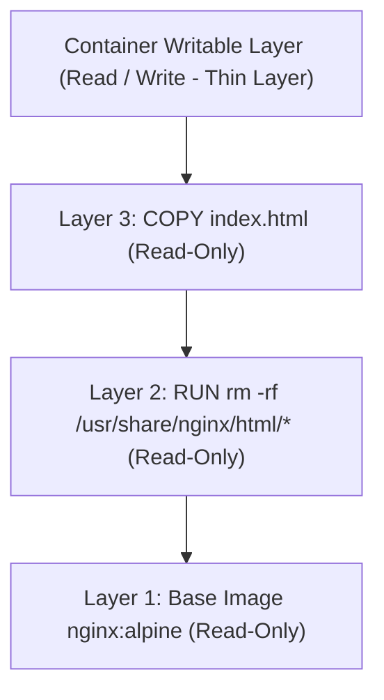

#### How Dockerfile Instructions Create Layers:
- Every instruction that alters the filesystem (`RUN`, `COPY`, `ADD`) creates a **new immutable layer**.
- Metadata instructions (`ENV`, `EXPOSE`, `WORKDIR`, `CMD`, `LABEL`) modify image configuration JSON without adding file payload layers.
- **Layer Caching**: When rebuilding an image, if a layer and all preceding layers have not changed, Docker reuses the cached layer (`---> Using cache`), saving bandwidth and build time.

---

### 7. Docker Containers & Namespaces / Cgroups

#### What is a Container at the Kernel Level?
A container is **NOT a virtual machine**. A container is simply a **standard Linux process** that is constrained by two fundamental Linux kernel features:
1. **Linux Namespaces** (What the process can **SEE**)
2. **Control Groups (cgroups)** (What the process can **USE**)

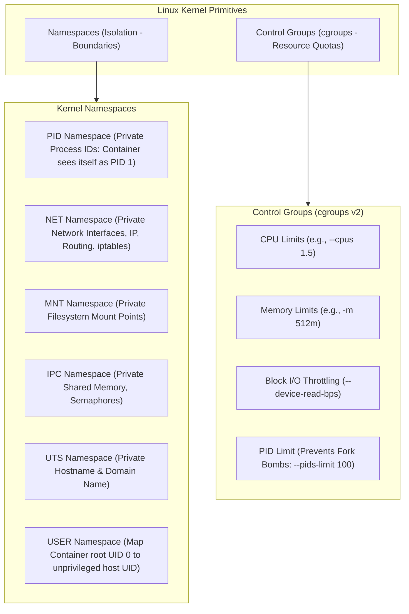

- When you start a container, the host kernel allocates private namespaces for it. Inside the container, your web server thinks it is PID 1 running on its own dedicated machine. On the host operating system, it is just process PID 4210.
- Cgroups prevent a single misbehaving container from consuming 100% of the host machine's RAM or CPU.

---

### 8. Container Runtime (`containerd` & `runc`)

In the early days of Docker (pre-2015), the Docker daemon handled everything monolithically. Today, Docker complies with the **Open Container Initiative (OCI)** standards and divides runtime duties into distinct layers:

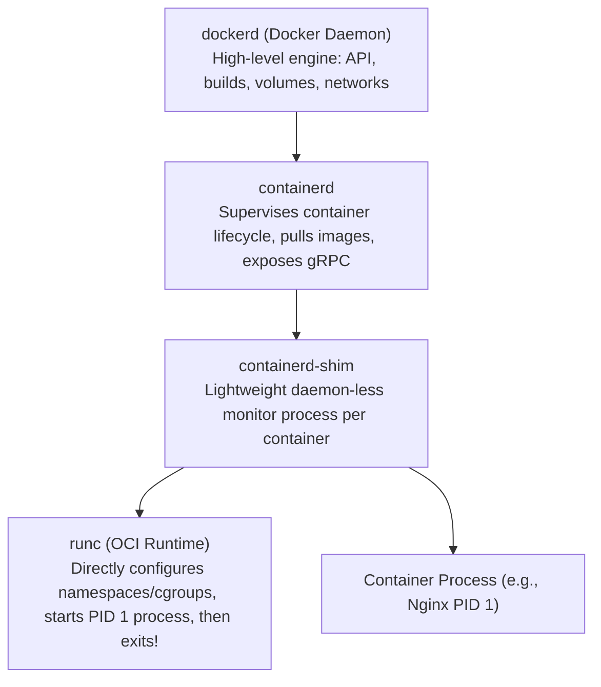

#### High-Level Runtime: `containerd`
- Donated by Docker to the Cloud Native Computing Foundation (CNCF).
- Manages complete container lifecycles: image transfer, execution, snapshot storage, and process supervision.
- Used not only by Docker, but also directly by Kubernetes as its default container runtime (CRI).

#### Low-Level Runtime: `runc`
- The official OCI reference implementation written in Go.
- Directly invokes Linux kernel system calls (`clone`, `unshare`, `pivot_root`, `setns`) to assemble namespaces and cgroups.
- **Key behavior:** `runc` creates the container process, hands supervision over to `containerd-shim`, and immediately exits!

#### Why `containerd-shim` is a Game Changer:
The `containerd-shim` process stays alive beside the container. It keeps standard input/output streams open and collects exit codes.  
**Advantage:** This architecture allows the main Docker daemon (`dockerd`) to crash, restart, or be upgraded without terminating or rebooting any running containers (known as **Live Restore**).

---

### 9. Docker Networking Subsystem

Docker provides software-defined networking so containers can communicate securely with each other and the outside world.

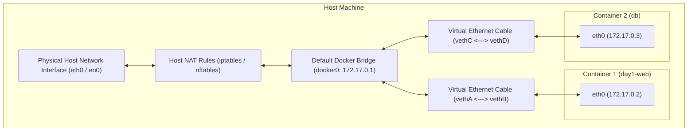

#### Core Network Drivers:
1. **Bridge (Default)**:  
   Creates a software bridge (`docker0` on Linux) with subnet `172.17.0.0/16`. Containers get private IP addresses connected via virtual Ethernet cable pairs (`veth`).
2. **Host**:  
   Removes network isolation completely (`--network host`). The container shares the host network namespace directly. Offers highest network performance, but risks port collisions.
3. **None**:  
   Disables all networking (`--network none`). The container only has a loopback interface (`127.0.0.1`). Ideal for secure batch processing jobs.
4. **Overlay**:  
   Enables multi-host communication across distributed Docker Swarm nodes without requiring OS-level routing.

#### Port Publishing Explained (`-p 8081:80`):
- Inside the container, Nginx listens on port `80`.
- The flag `-p 8081:80` configures the host kernel's `iptables` NAT (Network Address Translation) table:
  *Any incoming packet on host port 8081 is forwarded across the `docker0` bridge to IP `172.17.0.2:80`.*

---

### 10. Docker Storage Subsystem (Volumes & Bind Mounts)

Docker provides three distinct mechanisms for mounting files into containers:

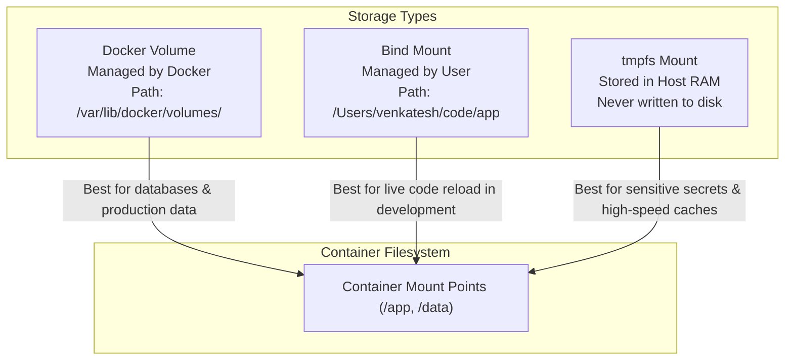

#### Comparison of Storage Mechanisms:

| Feature | Container Writable Layer | Docker Volume (`-v mydata:/data`) | Bind Mount (`-v /host:/container`) | tmpfs Mount (`--tmpfs /app`) |
| :--- | :--- | :--- | :--- | :--- |
| **Location** | OverlayFS diff folder | `/var/lib/docker/volumes/` | Arbitrary host filesystem path | Host volatile RAM |
| **Persistence** | **No** (Deleted on `docker rm`) | **Yes** (Independent of container) | **Yes** (Stored directly on host) | **No** (Erased on stop) |
| **Managed By** | Docker Storage Driver | Docker CLI & Daemon | User / Host Operating System | Host Kernel memory |
| **Performance** | Slower (CoW overhead) | Maximum native disk I/O | Fast (Host filesystem dependent) | Fastest (In-memory) |
| **Primary Use Case** | Temporary scratch data | Databases (PostgreSQL, MySQL) | Local dev code hot-reloading | Passwords, tokens, keys |

---

### 11. Docker Desktop on macOS

#### Why Docker Cannot Run Natively on macOS
Containers are **not** an abstract technology; they rely on specific **Linux kernel system calls** (Namespaces, cgroups, OverlayFS, netfilter).  
macOS runs the **XNU / Darwin kernel**. The macOS kernel does not have Linux namespaces or cgroups. Therefore:

> **You cannot run native Linux containers directly on the macOS kernel.**

#### How Docker Desktop Solves This:
Docker Desktop on macOS runs a **custom, ultra-lightweight Linux Virtual Machine** behind the scenes (powered by Apple's native Virtualization Framework or HyperKit).

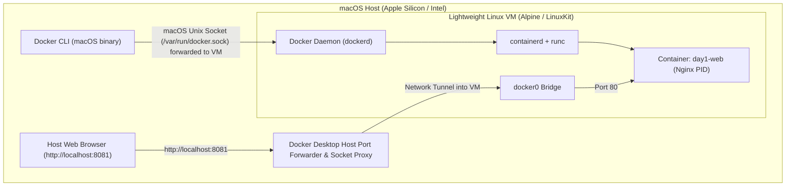

#### Key Architectural Details on macOS:
1. **The CLI is macOS Native**: When you type `docker` in Terminal, that executable is a macOS Mach-O binary.
2. **The Socket is Proxied**: `/var/run/docker.sock` on macOS is a socket forwarder that routes API calls directly into the Linux VM's Docker daemon.
3. **File Sharing (VirtioFS)**: When you bind-mount a macOS directory (`-v ~/code:/app`), Docker Desktop uses high-performance VirtioFS to synchronize files between macOS and the Linux VM.
4. **Networking Tunneling**: Container IP addresses (`172.17.0.2`) are private to the Linux VM and cannot be pinged directly from your Mac terminal. However, published ports (`-p 8081:80`) are transparently forwarded to `localhost:8081` on your Mac.

---

## 3. How Docker Works: End-to-End Workflow

Let us trace exactly what happens under the hood when a developer writes code and runs a container:

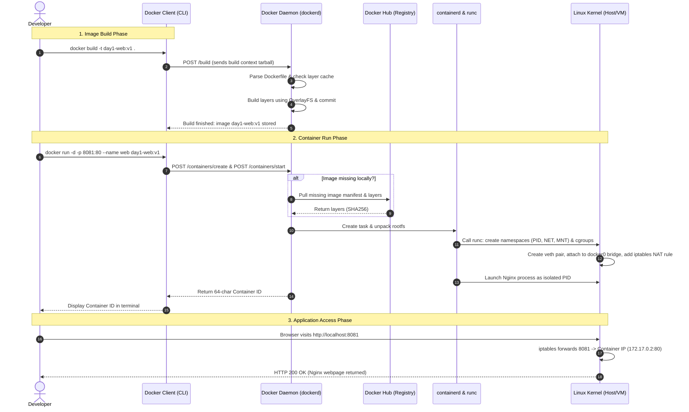

---

## 4. Docker Architecture vs. Virtual Machine Architecture

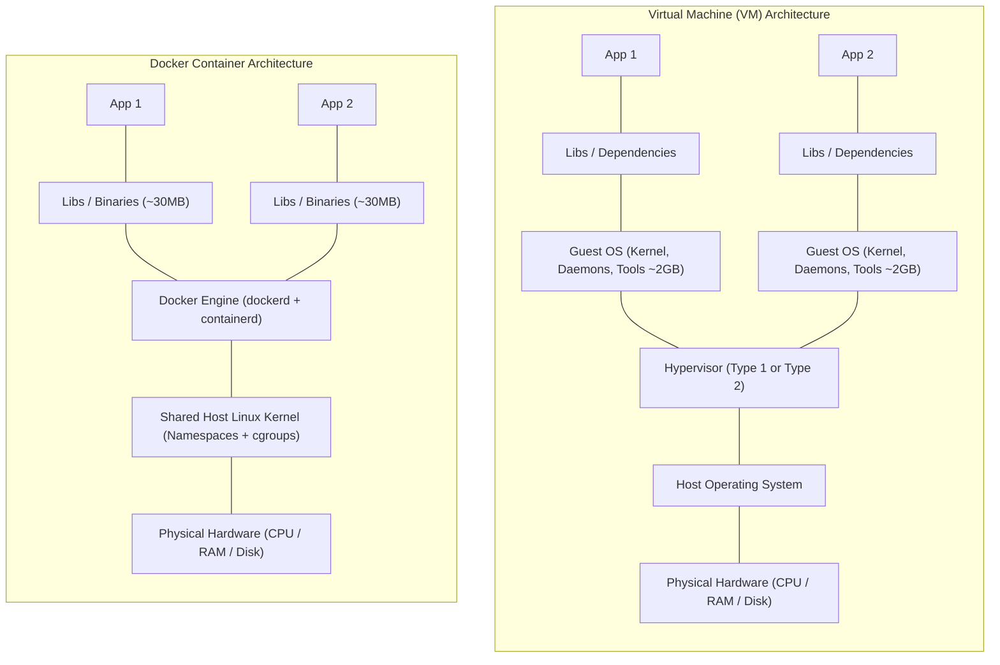

### In-Depth Comparison Table

| Attribute | Docker Container | Traditional Virtual Machine (VM) |
| :--- | :--- | :--- |
| **Operating System** | Shares the **host Linux kernel** directly. | Runs a **full, separate Guest OS** with its own kernel. |
| **Isolation Mechanism** | Software-level isolation via Linux **Namespaces** and **cgroups**. | Hardware-level hardware virtualization via a **Hypervisor** (ESXi, KVM, VirtualBox). |
| **Startup Time** | **Sub-second (Milliseconds)** (Process starts immediately). | **Minutes** (Must boot full OS kernel, load drivers, and run init). |
| **Memory Footprint** | Extremely low (**Megabytes**, e.g., 5MB–50MB for Alpine/Go/Nginx). | High (**Gigabytes**, minimum 1GB–4GB RAM allocated per VM). |
| **Disk Size** | Small (typically 10MB to 500MB). | Large (typically 10GB to 50GB per virtual disk image). |
| **CPU Performance** | **Near-native (Bare Metal)** execution speed; zero hypervisor overhead. | Slight CPU/IO tax due to hypervisor translation layers. |
| **Kernel Flexibility** | Containers must share host kernel capabilities. | Each VM can run an entirely different kernel (e.g. Windows on Linux host). |
| **Portability** | High: Runs identically wherever Docker Engine is installed. | Moderate: Exporting and importing heavy VMDK/OVF images is slow. |

---

## 5. Important Docker Commands by Architecture Component

Here is a reference table categorizing Docker commands by the architectural component they inspect or manipulate:

| Component | Command | Practical Example | What It Does Under the Hood |
| :--- | :--- | :--- | :--- |
| **Client & Daemon** | `docker version` | `docker version` | Queries both Client and Server API versions and Git commits. |
| | `docker info` | `docker info` | Returns system-wide daemon stats: storage driver, cgroup version, active containers. |
| | `docker system df` | `docker system df` | Analyzes disk usage consumed by images, containers, volumes, and build cache. |
| | `docker system events`| `docker system events` | Streams real-time architectural events emitted by the daemon. |
| **Registry & Images** | `docker login` | `docker login` | Authenticates client credentials against Docker Registry. |
| | `docker pull` | `docker pull nginx:alpine` | Downloads image manifest and unpacks layers into local storage. |
| | `docker push` | `docker push myuser/app:v1` | Uploads local layers to remote registry. |
| | `docker build` | `docker build -t app:v1 .` | Sends build context to daemon to create immutable layers. |
| | `docker images` | `docker images` | Lists all image layers stored locally in daemon's engine. |
| **Container Runtime** | `docker run` | `docker run -d -p 8081:80 app:v1`| Instructs `containerd` and `runc` to spawn an isolated container. |
| | `docker exec` | `docker exec -it app sh` | Spawns an auxiliary process inside an existing container namespace. |
| | `docker stop` | `docker stop app` | Signals `containerd` to send `SIGTERM` followed by `SIGKILL` to PID 1. |
| | `docker top` | `docker top app` | Queries kernel process table for PIDs associated with the container's PID namespace. |
| **Networks** | `docker network ls` | `docker network ls` | Lists all software bridges and virtual networks configured in daemon. |
| | `docker network inspect`| `docker network inspect bridge`| Displays subnet CIDR, gateway IP, and all connected container endpoints. |
| | `docker network create` | `docker network create custom-net`| Creates a user-defined bridge network with automatic embedded DNS service discovery. |
| **Storage Volumes** | `docker volume ls` | `docker volume ls` | Lists all persistent Docker volumes managed in `/var/lib/docker/volumes`. |
| | `docker volume inspect`| `docker volume inspect mydata`| Shows the exact absolute mount path on the host filesystem. |
| | `docker volume prune` | `docker volume prune -f` | Deletes all volumes not currently attached to any container. |
| **Multi-Container Batch** | Batch Stop | `docker stop $(docker ps -q)` | Stops all running containers by passing IDs to daemon. |
| | Batch Remove | `docker rm -f $(docker ps -aq)` | Force removes all containers across the system. |

---

## 6. Practical Architecture Example: Mac to Running Web App

Let us trace our Day 1 practice application through every single architectural component on a Mac:

```bash
docker run -d --name day1-web -p 8081:80 nginx:alpine
```

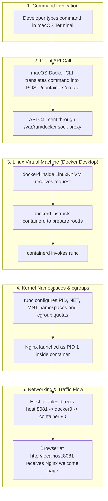

### Component-by-Component Trace:
1. **Docker CLI**: Reads `--name day1-web`, `-d`, `-p 8081:80`, and `nginx:alpine`. Formats JSON payload.
2. **Docker Socket Proxy**: Transmits HTTP request across the hypervisor boundary into the Docker Desktop Linux VM.
3. **Docker Daemon (`dockerd`)**: Verifies `nginx:alpine` exists in local layer store.
4. **`containerd`**: Allocates an OverlayFS snapshot for the thin writable layer.
5. **`runc`**: Assembles Linux namespaces:
   - Sets container hostname to container ID.
   - Sets container root to the mounted OverlayFS directory.
   - Creates a virtual Ethernet interface (`eth0`) with IP `172.17.0.2`.
   - Starts `/docker-entrypoint.sh nginx -g "daemon off;"`.
6. **Docker Desktop Proxy**: Binds `localhost:8081` on the macOS host and tunnels TCP connections into the VM's bridge.
7. **Developer Browser**: Requests `http://localhost:8081`. macOS delivers packet to proxy $\rightarrow$ VM $\rightarrow$ container $\rightarrow$ Nginx replies with HTML.

---

## 7. Architecture Troubleshooting & Security Best Practices

### 1. Docker Daemon Unavailable
```text
Cannot connect to the Docker daemon at unix:///var/run/docker.sock. Is the docker daemon running?
```
- **Root Cause**: The background service `dockerd` is stopped, crashed, or Docker Desktop is not running.
- **Diagnostic Command**:
  ```bash
  # Check if docker process is alive
  ps aux | grep -i docker
  ```
- **Fix**:
  - **macOS / Windows**: Launch the Docker Desktop application and wait for the status icon to turn green.
  - **Linux Server**: Run `sudo systemctl status docker` and `sudo systemctl start docker`.

### 2. Port Collision (`port is already allocated`)
```text
Error response from daemon: Bind for 0.0.0.0:8081 failed: port is already allocated.
```
- **Root Cause**: Another container or host program (e.g. Apache, Node.js) is already bound to port 8081.
- **Diagnostic Command**:
  ```bash
  # On macOS / Linux
  lsof -i :8081
  ```
- **Fix**: Either stop the conflicting process or map to an alternate port:
  ```bash
  docker run -d -p 8082:80 nginx:alpine
  ```

### 3. Insufficient Permissions on Docker Socket
```text
permission denied while trying to connect to the Docker daemon socket at unix:///var/run/docker.sock
```
- **Root Cause**: The current non-root Linux user is not in the `docker` security group.
- **Fix**:
  ```bash
  sudo usermod -aG docker $USER
  newgrp docker
  ```

### 4. Unsafe Exposure of Docker Daemon API
> [!CAUTION]
> If you expose the Docker daemon over TCP without mutual TLS authentication (`dockerd -H tcp://0.0.0.0:2375`), automated internet scanners can locate your host within minutes, spin up cryptocurrency mining containers, and gain full root control over your host operating system.
> 
> **Production Rule:** Always protect remote Docker connections with TLS client certificates on port `2376`, or tunnel through SSH:
> ```bash
> export DOCKER_HOST="ssh://user@remote-server"
> docker ps
> ```

---

## 8. Summary, Interview Questions & Architecture Checklist

### Summary of Docker Components

| Component | Responsibility | Technical Nature |
| :--- | :--- | :--- |
| **Docker Client** | Accepts user commands, converts them to REST calls. | Command-line CLI binary (`docker`) |
| **Docker Daemon** | High-level orchestration, coordinates images, networks, volumes. | Long-running background daemon (`dockerd`) |
| **REST API** | Standardized interface connecting Client to Daemon. | HTTP API over Unix Socket or TCP |
| **`containerd`** | Supervises container process lifecycles and image snapshots. | CNCF runtime daemon |
| **`runc`** | Interacts directly with Linux kernel to spawn container. | OCI-compliant low-level runtime |
| **Namespaces** | Provides process, network, and filesystem boundaries. | Linux Kernel feature |
| **Control Groups** | Restricts CPU, Memory, Disk I/O quotas. | Linux Kernel feature |
| **OverlayFS** | Stacks read-only image layers under a thin writable layer. | Linux Union Filesystem |
| **Registry** | Stores and distributes versioned container images. | Centralized cloud/on-prem service |

---

### Top Architecture Interview Questions & Answers

#### Q1: Can Docker run natively on macOS or Windows without a virtual machine?
**Answer:**  
No. Containers depend on native Linux kernel capabilities (Namespaces, cgroups, OverlayFS, and netfilter). Because macOS runs the XNU/Darwin kernel and Windows runs the NT kernel, neither possesses Linux kernel primitives. On macOS and Windows, Docker Desktop provisions a lightweight, optimized Linux Virtual Machine behind the scenes to run the Docker Engine and Linux containers.

#### Q2: What is the difference between `containerd` and `runc`?
**Answer:**  
- `runc` is a **low-level OCI container runtime**. Its sole job is to interact directly with the Linux kernel to create namespaces, configure cgroups, mount filesystems, start the container process, and then immediately exit.
- `containerd` is a **high-level container runtime**. It manages image downloads, unpacks filesystem layers, manages storage snapshots, coordinates container network attachments, and supervises `containerd-shim` instances.

#### Q3: How do Linux Namespaces differ from Control Groups (cgroups)?
**Answer:**  
- **Namespaces** provide **isolation** (what a container can **see**). They ensure a container cannot see or interact with processes, network interfaces, or mount points belonging to other containers or the host.
- **Control Groups (cgroups)** provide **resource management** (what a container can **use**). They impose hard limits and metering on CPU cycles, memory usage, block I/O bandwidth, and process counts (PIDs).

#### Q4: Why is mounting `/var/run/docker.sock` inside a container considered a critical security vulnerability?
**Answer:**  
The Docker socket provides full access to the Docker daemon REST API. Because the Docker daemon runs with root privileges on the host, a container with access to `/var/run/docker.sock` can instruct the daemon to launch an arbitrary privileged container that mounts the host's root filesystem (`/`). This bypasses all container isolation and grants the container full root control over the host operating system.

#### Q5: What is the difference between a Docker Image and a Docker Layer?
**Answer:**  
A **Docker Layer** is an immutable set of filesystem modifications created by a build instruction (such as `RUN` or `COPY`). A **Docker Image** is an ordered stack of these read-only layers accompanied by a configuration manifest that specifies the execution entrypoint, default environment variables, architecture, and user settings.

---

### Day 1 Architecture Revision Checklist
Use this checklist to ensure you have mastered Docker's architecture:
- [ ] Understand the Client-Server model and how the CLI talks to `dockerd`.
- [ ] Understand the role of the Unix Socket (`/var/run/docker.sock`).
- [ ] Can explain how Linux Namespaces (PID, NET, MNT, IPC, UTS, USER) provide process isolation.
- [ ] Can explain how Control Groups (cgroups) protect host memory and CPU.
- [ ] Know the difference between high-level runtime (`containerd`) and low-level runtime (`runc`).
- [ ] Understand how OverlayFS layers stack together to create the container filesystem.
- [ ] Understand why Docker Desktop requires a Linux VM on macOS.
- [ ] Can explain how host port mapping (`-p 8081:80`) works via `iptables` and NAT.
- [ ] Distinguish clearly between Docker Volumes, Bind Mounts, and tmpfs mounts.
- [ ] Can execute multi-container batch stop and cleanup operations.
