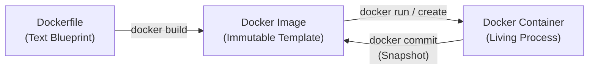
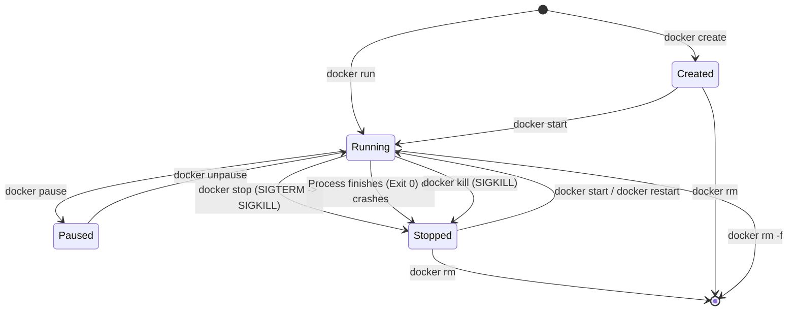
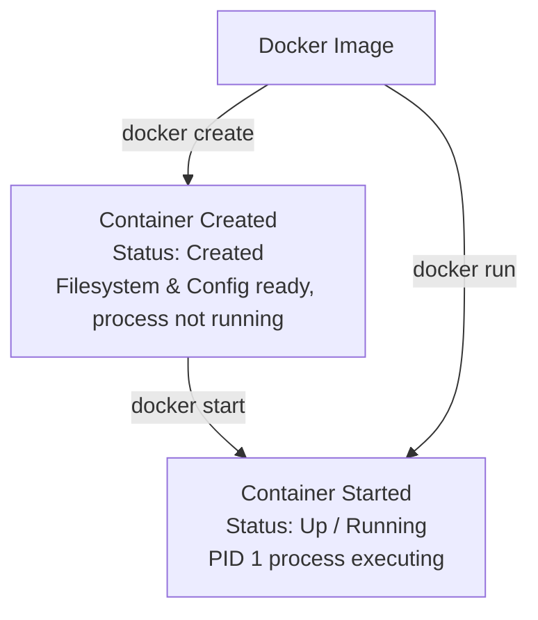

# 🐳 Docker Fundamentals: Complete Docker Lifecycle Guide

Welcome to Day 1 of your Docker journey! This guide covers the **Docker lifecycle** in comprehensive, beginner-friendly detail. By the end of this guide, you will master everything from writing a Dockerfile and building immutable images to creating, running, inspecting, troubleshooting, executing commands inside, managing, and safely cleaning up single and multiple containers.

---

## 📑 Table of Contents
1. [Introduction to the Docker Lifecycle](#1-introduction-to-the-docker-lifecycle)
2. [Dockerfile & Image Creation](#2-dockerfile--image-creation)
3. [Container Creation & Execution](#3-container-creation--execution)
4. [Container Inspection & Diagnostic Commands](#4-container-inspection--diagnostic-commands)
5. [Container Logs & Troubleshooting](#5-container-logs--troubleshooting)
6. [Executing Commands Inside Running Containers](#6-executing-commands-inside-running-containers)
7. [Working with Files Inside Containers](#7-working-with-files-inside-containers)
8. [Lifecycle Management, Batch Operations & Cleanup](#8-lifecycle-management-batch-operations--cleanup)
9. [Complete Hands-on Practice: Step-by-Step Exercise](#9-complete-hands-on-practice-step-by-step-exercise)
10. [Summary, Command Reference & Interview Preparation](#10-summary-command-reference--interview-preparation)

---

## 1. Introduction to the Docker Lifecycle

### What is the Docker Lifecycle?
The **Docker lifecycle** refers to the end-to-end journey of an application packaged with Docker:
1. **Definition**: Writing source code and a recipe (`Dockerfile`).
2. **Build**: Packaging the recipe and code into an immutable, portable template (`Image`).
3. **Execution**: Spawning, starting, pausing, and restarting isolated instances of that template (`Containers`).
4. **Observation**: Inspecting logs, process tables, resource consumption, and filesystems.
5. **Retirement**: Stopping and safely deleting containers and unused images to recover host resources.

### Why Understanding the Lifecycle is Crucial
Beginners often confuse images with containers, or assume that stopping a container destroys its data, or wonder why a container exits immediately after running `docker run`. 

Mastering the lifecycle helps you:
- **Predict container behavior**: Know exactly what state your container is in and why.
- **Troubleshoot production incidents quickly**: Understand whether a failure is due to a bad build, a misconfigured entrypoint, missing environment variables, or port collisions.
- **Manage disk and memory resources efficiently**: Avoid leaving dangling images and stopped containers consuming gigabytes of disk space.
- **Design stateless, reliable architectures**: Know when data persists and when it is lost.

### Dockerfile vs. Image vs. Container

To understand the lifecycle, you must understand the distinction between the three core Docker entities:



| Entity | Real-World Analogy | Programming Analogy | Mutability | What It Actually Is |
| :--- | :--- | :--- | :--- | :--- |
| **Dockerfile** | Architectural blueprint / Baking recipe | Source code / Class definition file | Modifiable text file | A plaintext file containing ordered instructions to build a Docker image. |
| **Image** | The baked cake / Pre-fabricated house | Compiled binary / Class in memory | **Immutable (Read-Only)** | A packaged snapshot consisting of stacked read-only filesystem layers and metadata. |
| **Container** | The party where the cake is eaten | An instantiated Object (`new App()`) | **Stateful (Thin R/W Layer)** | An isolated running Linux process tree with its own namespaces, cgroups, and a thin writable layer. |

> [!NOTE]
> An image never changes once built. When you run a container, Docker adds a thin, temporary **Read/Write (R/W) layer** on top of the image's read-only layers. All files created, modified, or deleted during runtime exist only in this thin writable layer.

### Docker Lifecycle State Machine

A container transitions through specific lifecycle states. The diagram below illustrates every possible state and the Docker commands that trigger each transition:



---

## 2. Dockerfile & Image Creation

### What is a Dockerfile and Why Use It?
A **Dockerfile** is a plain text file without any file extension named `Dockerfile`. It contains a sequential series of instructions that tell Docker how to assemble an image layer by layer.

**Why use a Dockerfile?**
- **Automated & Reproducible Builds**: Anyone on any machine can run `docker build` and get the exact same environment.
- **Version Controlled Infrastructure**: Dockerfiles live in Git alongside your application code.
- **Layer Caching**: Docker caches intermediate layers, making subsequent builds remarkably fast.

### Structure & Essential Dockerfile Instructions

Every instruction in a Dockerfile is typically written in uppercase followed by arguments:

```dockerfile
INSTRUCTION argument
```

Here are the 9 most fundamental instructions you must know:

| Instruction | Purpose | Example | Key Difference / Note |
| :--- | :--- | :--- | :--- |
| `FROM` | Defines the base image. **Must be the first non-comment instruction.** | `FROM nginx:alpine` | Always use specific tags (e.g., `alpine`, `node:18-bullseye-slim`) rather than `latest` in production. |
| `WORKDIR` | Sets the active working directory inside the container for all subsequent instructions. | `WORKDIR /usr/share/nginx/html` | Creates the directory automatically if it does not exist. Avoid using `RUN cd /path`. |
| `COPY` | Copies files or directories from your host machine into the container filesystem. | `COPY ./index.html .` | Preferred over `ADD` for standard local file copying. |
| `ADD` | Like `COPY`, but also extracts local tarballs automatically and can fetch remote URLs. | `ADD archive.tar.gz /app/` | Use `COPY` unless you explicitly need tar auto-extraction. |
| `RUN` | Executes commands **during the build stage** to install packages or build code. Creates a new layer. | `RUN apk add --no-cache curl` | Runs once during build time, not when the container boots. |
| `ENV` | Sets persistent environment variables available during build and runtime. | `ENV PORT=80 \ APP_ENV=production` | Accessible by your app via `process.env` (Node), `os.environ` (Python), etc. |
| `EXPOSE` | Documents the port on which the container application intends to listen. | `EXPOSE 80` | **Documentation only!** It does not actually publish or open ports to the host machine. |
| `CMD` | Provides default arguments or commands for the container **when it boots**. | `CMD ["nginx", "-g", "daemon off;"]` | Overridable from the command line (`docker run myapp custom_command`). |
| `ENTRYPOINT` | Sets the fixed executable that will always run when the container starts. | `ENTRYPOINT ["nginx"]` | Harder to override. Arguments passed to `docker run` are appended to `ENTRYPOINT`. |

> [!TIP]
> **`CMD` vs `ENTRYPOINT` in a nutshell:**
> - `CMD ["echo", "Hello"]`: Running `docker run myimg Bye` executes `Bye` (completely overrides `CMD`).
> - `ENTRYPOINT ["echo"]` + `CMD ["Hello"]`: Running `docker run myimg Bye` executes `echo Bye` (`Bye` replaces `Hello` as argument to `echo`).

### Example Dockerfile
Here is a production-ready, lightweight Dockerfile serving a custom HTML page using Nginx on Alpine Linux:

```dockerfile
# Step 1: Use an official lightweight Nginx image
FROM nginx:alpine

# Step 2: Set metadata
LABEL maintainer="learning-docker@example.com"
LABEL description="Day 1 Nginx practice web application"

# Step 3: Set working directory inside container
WORKDIR /usr/share/nginx/html

# Step 4: Remove default Nginx welcome page
RUN rm -rf ./*

# Step 5: Copy our custom website file from host to container
COPY index.html ./index.html

# Step 6: Set environment variable
ENV ENVIRONMENT=development

# Step 7: Document container port
EXPOSE 80

# Step 8: Start Nginx in foreground mode so container does not exit
CMD ["nginx", "-g", "daemon off;"]
```

### Building an Image with `docker build`

#### The Build Command Syntax
```bash
docker build [OPTIONS] PATH | URL
```

#### The Build Context
The final argument `.` specifies the **Build Context**:
```bash
docker build -t day1-web:v1 .
```
The build context is the local directory sent to the Docker daemon. Any file copied via `COPY` or `ADD` must reside within this context. Docker cannot reach outside the build context (e.g., `COPY ../secret.txt .` will fail).

#### Breakdown of Flags:
- `-t day1-web:v1`: Tags the image with `name:tag` format (`day1-web` is repository name, `v1` is tag).
- `.`: The current working directory as the build context.
- `-f /path/to/Dockerfile`: (Optional) Specifies an alternate Dockerfile name/path if not named `Dockerfile`.
- `--no-cache`: (Optional) Forces Docker to rebuild all layers without using cached layers.

#### Example Command & Expected Output:
```bash
$ docker build -t day1-web:v1 .
```
```text
[+] Building 1.2s (8/8) FINISHED                                docker:desktop-linux
 => [internal] load build definition from Dockerfile                            0.0s
 => => transferring dockerfile: 312B                                            0.0s
 => [internal] load metadata for docker.io/library/nginx:alpine                 0.8s
 => [internal] load .dockerignore                                               0.0s
 => [1/4] FROM docker.io/library/nginx:alpine@sha256:a29f...                   0.0s
 => [2/4] WORKDIR /usr/share/nginx/html                                         0.0s
 => [3/4] RUN rm -rf ./*                                                        0.2s
 => [4/4] COPY index.html ./index.html                                          0.0s
 => exporting to image                                                          0.1s
 => => exporting layers                                                         0.1s
 => => writing image sha256:7e45b128c9b3a...                                   0.0s
 => => naming to docker.io/library/day1-web:v1                                  0.0s
```

### Image Tagging, Naming Conventions, and Registries
Docker image names follow a standard structure:
```text
[registry_host[:port]/][namespace_or_username/]repository_name[:tag]
```
- **Local name without registry**: `day1-web:v1`
- **Docker Hub user image**: `venkatesh/day1-web:v1`
- **Private registry image**: `myregistry.company.com:5000/devops/day1-web:v1.0.0`
- **Default tag**: If you omit `:tag`, Docker defaults to `:latest`.

### Image Management Commands

#### 1. List Images (`docker images` / `docker image ls`)
Lists all images available in your local Docker store:
```bash
docker images
```
*Expected Output:*
```text
REPOSITORY   TAG       IMAGE ID       CREATED         SIZE
day1-web     v1        7e45b128c9b3   2 minutes ago   41.2MB
nginx        alpine    91b4b3c0e123   5 days ago      41.2MB
ubuntu       latest    35a88802559d   2 weeks ago     77.8MB
```

#### 2. Inspect an Image (`docker image inspect`)
Outputs the complete low-level JSON configuration (architecture, environment variables, layers, entrypoint, exposed ports):
```bash
docker image inspect day1-web:v1
```
*Filter with `--format` to view specific fields:*
```bash
docker image inspect --format '{{.Architecture}} - {{.Os}}' day1-web:v1
# Output: arm64 - linux (or amd64 - linux)
```

#### 3. View Image History (`docker history`)
Shows how the image was constructed layer by layer, including each command and layer size:
```bash
docker history day1-web:v1
```
*Expected Output:*
```text
IMAGE          CREATED         CREATED BY                                      SIZE      COMMENT
7e45b128c9b3   3 minutes ago   CMD ["nginx" "-g" "daemon off;"]                0B        buildkit.dockerfile.v0
<missing>      3 minutes ago   EXPOSE map[80/tcp:{}]                           0B        buildkit.dockerfile.v0
<missing>      3 minutes ago   ENV ENVIRONMENT=development                     0B        buildkit.dockerfile.v0
<missing>      3 minutes ago   COPY index.html ./index.html                    342B      buildkit.dockerfile.v0
<missing>      3 minutes ago   RUN /bin/sh -c rm -rf ./*                       0B        buildkit.dockerfile.v0
<missing>      3 minutes ago   WORKDIR /usr/share/nginx/html                   0B        buildkit.dockerfile.v0
```

#### 4. Tag an Image (`docker tag`)
Creates an alias (pointer) pointing to the same underlying Image ID. It does **not** copy the files or duplicate disk space:
```bash
docker tag day1-web:v1 day1-web:v2
docker tag day1-web:v1 myusername/day1-web:latest
```

#### 5. Remove an Image (`docker rmi` / `docker image rm`)
Deletes an image tag or untags an image:
```bash
docker rmi day1-web:v2
```
> [!WARNING]
> You cannot remove an image if a container (even a stopped container) is currently using it. You will see: `Error response from daemon: conflict: unable to delete ... image is being used by running/stopped container`. Remove the container first!

#### 6. Remove Multiple Images at Once (Batch Operations)
```bash
# Delete multiple specific images
docker rmi image1:v1 image2:v1 image3:v1

# Remove all dangling (untagged <none>) images
docker rmi $(docker images -f "dangling=true" -q)

# Remove all unused images not referenced by any container
docker image prune -a -f
```

---

## 3. Container Creation & Execution

### How Containers Are Created From Images
When Docker creates a container from an image:
1. It allocates a unique Container ID and assigns a random (or specified) name.
2. It allocates private Linux namespaces (Process IDs, Mount points, Network interfaces, IPC, Hostname).
3. It applies cgroups (resource limits on CPU, RAM).
4. It stacks a **thin writable Read/Write layer** on top of the image's immutable read-only layers.

### `docker create` vs. `docker start` vs. `docker run`

Understanding this relationship clarifies the entire Docker model:

$$\text{docker run} = \text{docker create} + \text{docker start} \;(+\; \text{docker attach \text{ if foreground}})$$



#### Step-by-Step Demonstration:
```bash
# 1. Create container (does NOT start PID 1 process)
$ docker create --name my-created-web -p 8081:80 day1-web:v1
a8f10b2c34d5...

# Check status: note status is "Created"
$ docker ps -a --filter "name=my-created-web"
CONTAINER ID   IMAGE         COMMAND                  CREATED         STATUS    PORTS     NAMES
a8f10b2c34d5   day1-web:v1   "/docker-entrypoint.…"   5 seconds ago   Created             my-created-web

# 2. Start container
$ docker start my-created-web
my-created-web

# Check status again: note status is "Up"
$ docker ps --filter "name=my-created-web"
CONTAINER ID   IMAGE         COMMAND                  CREATED          STATUS         PORTS                  NAMES
a8f10b2c34d5   day1-web:v1   "/docker-entrypoint.…"   25 seconds ago   Up 3 seconds   0.0.0.0:8081->80/tcp   my-created-web
```

### Foreground vs. Detached Mode (`-d`)

- **Foreground Mode (Default)**:
  ```bash
  docker run -p 8081:80 day1-web:v1
  ```
  Your terminal attaches directly to the container's standard output. You will see live logs. Pressing `Ctrl + C` sends a `SIGINT` signal to the container process, stopping the container!
  
- **Detached Mode (`-d`)**:
  ```bash
  docker run -d -p 8081:80 --name day1-web-container day1-web:v1
  ```
  Runs the container in the background as a daemon. Docker prints the full 64-character container ID and returns your command prompt immediately. The container keeps running in the background.

### Interactive Mode & Terminal Allocation (`-i`, `-t`, `-it`)
When you want to run a temporary shell or interactive container (e.g., Ubuntu, Alpine, Python):
- `-i` (`--interactive`): Keeps standard input (`STDIN`) open even if not attached.
- `-t` (`--tty`): Allocates a pseudo-TTY (terminal emulator), giving you a colored prompt, cursor movements, and line editing.
- `-it`: Combines both flags.

```bash
docker run -it --name test-box ubuntu:latest bash
# You are now inside the Ubuntu container prompt:
# root@4a7c8e9f1234:/# 
```

### Container Naming (`--name`) and Port Publishing (`-p`)

- **`--name <name>`**: Gives the container a human-friendly name (e.g., `day1-web-container`). If omitted, Docker assigns two random words (e.g., `agitated_hopper`, `nervous_curie`).
- **Port Publishing (`-p <host_port>:<container_port>`)**:
  - Container port `80` is internal to the container's isolated network.
  - `-p 8081:80` instructs Docker to forward incoming traffic from host port `8081` to container port `80`.
  - Accessible on host via `http://localhost:8081`.

### Running Multiple Containers Simultaneously

Because containers are lightweight isolated process groups, you can run multiple independent containers from the same image simultaneously:

```bash
# Run 3 web containers on different host ports
docker run -d --name web-prod-1 -p 8081:80 day1-web:v1
docker run -d --name web-prod-2 -p 8082:80 day1-web:v1
docker run -d --name web-prod-3 -p 8083:80 day1-web:v1
```

Or run multiple containers using a bash loop:
```bash
# Launch 5 containers from port 8091 to 8095
for port in {8091..8095}; do
  docker run -d --name "app-worker-${port}" -p "${port}:80" day1-web:v1
done
```

Verify all are running:
```bash
docker ps --filter "name=app-worker"
```

---

## 4. Container Inspection & Diagnostic Commands

Once containers are running, Docker provides inspection tools to monitor their health, networking, configuration, and resource usage.

### 1. `docker ps` vs. `docker ps -a` / `docker container ls`
- **`docker ps`** (or `docker container ls`): Shows **only currently running** containers.
- **`docker ps -a`** (or `docker container ls -a`): Shows **all** containers (running, stopped, created, exited, paused).

```bash
docker ps
```
*Important Columns:*
- `CONTAINER ID`: Short 12-character hash of container.
- `IMAGE`: Base image used.
- `COMMAND`: The root executable running as PID 1.
- `CREATED`: Elapsed time since creation.
- `STATUS`: Current state (e.g., `Up 5 minutes`, `Exited (0) 10 seconds ago`, `Up 2 hours (Paused)`).
- `PORTS`: Published host port mappings.
- `NAMES`: Unique container name.

### 2. `docker inspect <container>`
Returns comprehensive JSON metadata about everything Docker knows about the container: configuration, environment variables, mounts, network settings, IP address, state, and restart counts.

```bash
docker inspect day1-web-container
```

#### Filtering with Go Templates (`--format`):
Instead of reading 300 lines of JSON, use Go formatting:
```bash
# Get container status:
docker inspect --format '{{.State.Status}}' day1-web-container
# Output: running

# Get container IP address inside Docker internal bridge network:
docker inspect --format '{{range .NetworkSettings.Networks}}{{.IPAddress}}{{end}}' day1-web-container
# Output: 172.17.0.2

# Get container PID (Process ID on Linux host / VM):
docker inspect --format '{{.State.Pid}}' day1-web-container

# Get container restart count:
docker inspect --format '{{.RestartCount}}' day1-web-container
```

### 3. `docker stats` (Live Resource Telemetry)
Displays a live data stream of CPU, memory usage, memory limit, network I/O, and block I/O:

```bash
# Monitor specific container
docker stats day1-web-container

# Monitor all running containers with a single snapshot (no continuous stream)
docker stats --no-stream
```

*Expected Output:*
```text
CONTAINER ID   NAME                 CPU %     MEM USAGE / LIMIT     MEM %     NET I/O           BLOCK I/O   PIDS
4a7c8e9f1234   day1-web-container   0.02%     4.125MiB / 7.669GiB   0.05%     1.24kB / 2.38kB   0B / 0B     3
```

### 4. `docker top <container>`
Displays the active processes running **inside** the container, showing their host PID, user, and command:
```bash
docker top day1-web-container
```
*Expected Output:*
```text
UID     PID     PPID    C   STIME   TTY   TIME       CMD
root    4210    4188    0   10:14   ?     00:00:00   nginx: master process nginx -g daemon off;
101     4255    4210    0   10:14   ?     00:00:00   nginx: worker process
101     4256    4210    0   10:14   ?     00:00:00   nginx: worker process
```

### 5. `docker port <container>`
Displays public-to-private port mappings:
```bash
docker port day1-web-container
```
*Expected Output:*
```text
80/tcp -> 0.0.0.0:8081
80/tcp -> [::]:8081
```

### 6. `docker diff <container>`
Inspects the container's thin writable layer to show all files added, modified, or deleted compared to the base image:
```bash
docker diff day1-web-container
```
*Output Prefix Indicators:*
- `A`: File or directory **Added**.
- `C`: File or directory **Changed** (modified).
- `D`: File or directory **Deleted**.

```text
C /var
C /var/cache
C /var/cache/nginx
A /var/cache/nginx/client_temp
C /run
A /run/nginx.pid
```

---

## 5. Container Logs & Troubleshooting

### Understanding Container Logging
When applications run inside Docker, Docker captures everything written to standard output (`stdout` - stream 1) and standard error (`stderr` - stream 2) using its configured logging driver (default is `json-file`).

> [!IMPORTANT]
> If your application writes logs to an internal file (e.g. `/var/log/my-app.log`) instead of `stdout`/`stderr`, `docker logs` will be empty! Production containerized applications should either log directly to `stdout`/`stderr` or symlink their log files to `/dev/stdout` and `/dev/stderr` (which is exactly what official Nginx and Apache images do).

### Viewing and Streaming Logs

```bash
# 1. View all logs accumulated since container start
docker logs day1-web-container

# 2. Follow / Stream logs in real-time (like 'tail -f')
docker logs -f day1-web-container

# 3. View only the last 50 lines
docker logs --tail 50 day1-web-container

# 4. View logs from the last 10 minutes
docker logs --since 10m day1-web-container

# 5. Show precise timestamps for each log entry
docker logs -t day1-web-container

# 6. Combine flags (Follow the last 20 lines with timestamps)
docker logs -f -t --tail 20 day1-web-container
```

### Diagnosing Common Container Failure Scenarios

#### Scenario 1: Container Exits Immediately (`Exited (0)` or `Exited (1)`)
A container only stays alive as long as its **root process (PID 1)** is running. If PID 1 finishes or crashes, Docker terminates the container.
- **`Exited (0)`**: The process finished its task normally and exited cleanly (e.g., `docker run ubuntu echo "hello"` runs `echo` and exits).
- **`Exited (1)` or non-zero**: The application threw an unhandled error or exception during startup.

*Troubleshooting Steps:*
1. Run `docker ps -a` to find the exit code.
2. Run `docker logs <container-id>` to read the stack trace or fatal error.

#### Scenario 2: Port Collision (`bind: address already in use`)
```text
Error response from daemon: driver failed programming external connectivity on endpoint ...: 
Bind for 0.0.0.0:8081 failed: port is already allocated.
```
*Cause:* Another container or host process is already listening on port `8081`.  
*Fix:*
1. Check running containers: `docker ps`.
2. Check host port usage (macOS / Linux): `lsof -i :8081`.
3. Choose a different host port (e.g., `-p 8082:80`).

---

## 6. Executing Commands Inside Running Containers

### `docker exec` Deep Dive
`docker exec` allows you to run a new process **inside an already running container**. It is the primary tool for live debugging, inspecting environment variables, running database migrations, and testing internal connectivity.

### `docker exec` vs. `docker run` vs. `docker attach`

| Command | Action | When to Use |
| :--- | :--- | :--- |
| `docker run` | Creates and starts a **brand new container** from an image. | To run an application or container instance. |
| `docker exec` | Spawns a **new child process** inside an *already running* container. | To debug, inspect, or manage an active container. |
| `docker attach` | Attaches your terminal directly to the container's **existing PID 1 process**. | To view the primary console. Dangerous: pressing `Ctrl + C` stops the entire container! |

### Opening an Interactive Shell Session

```bash
# For containers with Bash (Ubuntu, Debian, CentOS, Node, Python):
docker exec -it day1-web-container bash

# For minimal containers with only Bourne Shell (Alpine Linux):
docker exec -it day1-web-container sh
```

#### What `-i` and `-t` Mean:
- `-i` keeps `STDIN` open so your keystrokes are transmitted into the container.
- `-t` allocates a pseudo-TTY so you get bash prompt formatting, line breaks, and command history.

> [!TIP]
> **Why does `docker exec -it <container> bash` fail on Alpine?**  
> Alpine Linux uses `musl-libc` and `busybox`. It does not include `bash` by default to keep image size small (~5MB). If you try `bash`, you will get:  
> `OCI runtime exec failed: exec: "bash": executable file not found in $PATH`.  
> Always use `sh` for Alpine images!

### Running Non-Interactive Single Commands
You do not need to open an interactive shell to run a command. You can pass the command directly:

```bash
# Check current working directory
docker exec day1-web-container pwd
# Output: /usr/share/nginx/html

# List files in container root
docker exec day1-web-container ls -la /

# Check container operating system release
docker exec day1-web-container cat /etc/os-release

# Inspect environment variables inside the container
docker exec day1-web-container env

# Check running processes inside the container
docker exec day1-web-container ps aux
```

### How to Safely Exit the Shell
When inside an interactive shell session started via `docker exec -it <container> sh`:
- Simply type `exit` and hit Enter (or press `Ctrl + D`).
- Because `docker exec` spawned an auxiliary process, exiting this shell **does not stop the container**. The main process (PID 1, Nginx) continues running undisturbed.

---

## 7. Working with Files Inside Containers

### Inspecting Files Directly
You can inspect files without modifying them:
```bash
docker exec day1-web-container ls -l /usr/share/nginx/html
docker exec day1-web-container cat /usr/share/nginx/html/index.html
```

### Copying Files with `docker cp`
`docker cp` enables bidirectional file and directory copying between your host machine and a container (whether the container is running or stopped).

#### Copying from Host into Container:
```bash
# Syntax: docker cp <host-path> <container>:<container-path>
docker cp ./index.html day1-web-container:/usr/share/nginx/html/index.html
```

#### Copying from Container to Host:
```bash
# Syntax: docker cp <container>:<container-path> <host-path>
docker cp day1-web-container:/etc/nginx/nginx.conf ./nginx-backup.conf
docker cp day1-web-container:/etc/os-release ./container-os-release.txt
```

### The Copy-on-Write (CoW) Mechanism
How does Docker handle file modification?
1. An image is composed of **stacked, read-only layers**.
2. When a container starts, Docker mounts a **thin writable container layer** on top.
3. If a process modifies an existing file from an underlying image layer, Docker uses **Copy-on-Write (CoW)**:
   - The file is copied up from the read-only image layer into the writable layer.
   - The modification is applied to this new copy.
   - The underlying image file remains untouched!
4. You can see these modifications using `docker diff day1-web-container`.

### The Ephemeral Nature of Containers & Persistent Data
> [!WARNING]
> **Container storage is ephemeral by default!**  
> Any changes written to the container's writable layer exist only while that container exists. When you run `docker rm day1-web-container`, the thin writable layer and all data inside it are permanently deleted.
> 
> For persistent data (databases, uploaded assets, configurations), always use **Docker Volumes** or **Bind Mounts**.

---

## 8. Lifecycle Management, Batch Operations & Cleanup

### Lifecycle Control Commands

```bash
# 1. Stop a running container gracefully (sends SIGTERM, waits 10s, then sends SIGKILL)
docker stop day1-web-container

# 2. Stop immediately without grace period (sends SIGKILL)
docker kill day1-web-container

# 3. Start a stopped container (preserves all writable layer modifications!)
docker start day1-web-container

# 4. Restart a container (stop + start)
docker restart day1-web-container

# 5. Pause a container (freezes all processes using cgroups freezer, consumes 0% CPU)
docker pause day1-web-container

# 6. Unpause a paused container (resumes execution instantly)
docker unpause day1-web-container

# 7. Rename a container
docker rename day1-web-container day1-web-production
```

### Removing Containers Safely vs. Forcefully

```bash
# Remove a stopped container
docker rm day1-web-production

# Attempting to remove a RUNNING container will fail:
# Error: You cannot remove a running container ... Stop the container before attempting removal or force remove

# Force remove a running container (Sends SIGKILL and removes immediately)
docker rm -f day1-web-production
```

### Batch Operations: Managing Multiple Containers at Once

As a DevOps engineer, managing containers one by one is inefficient. Here are standard commands for batch operations:

#### 1. Stop Multiple Containers
```bash
# Stop specific containers together
docker stop web1 web2 web3

# Stop ALL running containers
docker stop $(docker ps -q)
```
*(Explanation: `docker ps -q` returns only container IDs of running containers; `$(...)` substitutes these IDs into `docker stop`).*

#### 2. Remove Multiple Containers
```bash
# Remove specific containers
docker rm web1 web2 web3

# Remove all stopped containers
docker rm $(docker ps -a -q -f status=exited)

# Kill and remove ALL containers on the system (Nuclear Option!)
docker rm -f $(docker ps -aq)
```

#### 3. Prune Commands (Safe Bulk Garbage Collection)
```bash
# Remove all stopped containers
docker container prune -f

# Remove all stopped containers created more than 24 hours ago
docker container prune --filter "until=24h" -f

# Total cleanup: removes stopped containers, unused networks, and dangling images
docker system prune -f

# Deep cleanup: removes stopped containers, unused networks, ALL unused images, and unused volumes
docker system prune -a --volumes -f
```

### Difference Between Removing a Container and Removing an Image

| Action | Command | What It Deletes | Impact |
| :--- | :--- | :--- | :--- |
| **Remove Container** | `docker rm <id>` | The running/stopped container instance and its thin writable R/W layer. | The base image remains intact. You can launch 10 new containers from it. |
| **Remove Image** | `docker rmi <id>` | The stored immutable layers and image tags from local storage. | You cannot launch new containers from this image until you rebuild or pull it again. |

---

## 9. Complete Hands-on Practice: Step-by-Step Exercise

Follow this hands-on exercise from start to finish to solidify your understanding of every lifecycle phase.

### Step 1: Create Project Directory
```bash
mkdir -p ~/docker-day1-practice
cd ~/docker-day1-practice
```

### Step 2: Create a Simple HTML Application
Create a file named `index.html`:
```html
<!DOCTYPE html>
<html lang="en">
<head>
    <meta charset="UTF-8">
    <meta name="viewport" content="width=device-width, initial-scale=1.0">
    <title>Docker Day 1 Practice</title>
    <style>
        body {
            font-family: -apple-system, BlinkMacSystemFont, "Segoe UI", Roboto, sans-serif;
            background: #0f172a;
            color: #f8fafc;
            display: flex;
            justify-content: center;
            align-items: center;
            height: 100vh;
            margin: 0;
        }
        .card {
            background: #1e293b;
            padding: 2.5rem;
            border-radius: 12px;
            box-shadow: 0 10px 25px rgba(0,0,0,0.5);
            text-align: center;
            max-width: 500px;
        }
        h1 { color: #38bdf8; margin-bottom: 0.5rem; }
        p { color: #94a3b8; line-height: 1.6; }
        .tag {
            display: inline-block;
            background: #0284c7;
            color: white;
            padding: 0.25rem 0.75rem;
            border-radius: 9999px;
            font-weight: 600;
            font-size: 0.85rem;
        }
    </style>
</head>
<body>
    <div class="card">
        <h1>🐳 Docker Day 1 Success!</h1>
        <p>My custom Nginx web application is running smoothly inside an isolated Docker container.</p>
        <span class="tag">Status: Container Running</span>
    </div>
</body>
</html>
```

### Step 3: Write the Dockerfile
Create a file named `Dockerfile` in the same directory:
```dockerfile
FROM nginx:alpine
WORKDIR /usr/share/nginx/html
RUN rm -rf ./*
COPY index.html ./index.html
ENV APP_NAME="Day1-Nginx-App"
EXPOSE 80
CMD ["nginx", "-g", "daemon off;"]
```

### Step 4: Build the Custom Docker Image
```bash
docker build -t day1-web:v1 .
```
Verify the image was created:
```bash
docker images day1-web:v1
```

### Step 5: Run the Container in Detached Mode with Port Mapping
```bash
docker run -d --name my-day1-app -p 8081:80 day1-web:v1
```
*Expected Output:*
Docker prints the container ID (e.g., `e3b0c44298fc...`).

### Step 6: Verify and Access the Application
Open your web browser and navigate to:
```text
http://localhost:8081
```
Or test via curl in your terminal:
```bash
curl -I http://localhost:8081
```
*Expected Output:*
```text
HTTP/1.1 200 OK
Server: nginx/...
Content-Type: text/html
...
```

### Step 7: Inspect Container Metadata & Status
```bash
# Check status in process list
docker ps --filter "name=my-day1-app"

# Inspect container status using Go template formatting
docker inspect --format 'Status: {{.State.Status}} | IP: {{range .NetworkSettings.Networks}}{{.IPAddress}}{{end}}' my-day1-app
# Output: Status: running | IP: 172.17.0.2

# Check live port mapping
docker port my-day1-app
# Output: 80/tcp -> 0.0.0.0:8081
```

### Step 8: View and Stream Container Logs
```bash
# View all logs
docker logs my-day1-app

# Request the webpage again in another terminal tab to generate a log entry:
curl http://localhost:8081

# View the last 5 logs with timestamps
docker logs -t --tail 5 my-day1-app
```

### Step 9: Execute Commands Inside the Container
```bash
# Check operating system of container
docker exec my-day1-app cat /etc/os-release

# Inspect active processes
docker exec my-day1-app ps aux

# Open an interactive shell inside the container
docker exec -it my-day1-app sh
```
*Inside the shell:*
```sh
/usr/share/nginx/html # ls -la
/usr/share/nginx/html # cat index.html
/usr/share/nginx/html # exit
```

### Step 10: Copy Files In and Out of the Container
```bash
# 1. Copy a file out of the container to your host
docker cp my-day1-app:/usr/share/nginx/html/index.html ./downloaded-index.html
ls -l downloaded-index.html

# 2. Modify downloaded file locally or create a new file
echo "<h1>Updated from Host via docker cp!</h1>" > ./patch.html

# 3. Copy the patch file into the container
docker cp ./patch.html my-day1-app:/usr/share/nginx/html/index.html

# 4. Check changes using docker diff
docker diff my-day1-app
```
Refresh `http://localhost:8081` in your browser to observe the live update!

### Step 11: Stop, Start, and Restart Container
```bash
# Stop the container
docker stop my-day1-app

# Verify it is no longer listed in running containers
docker ps --filter "name=my-day1-app"
# (Empty)

# Verify it is listed in all containers
docker ps -a --filter "name=my-day1-app"
# STATUS: Exited (0)

# Start it back up (your copied patch.html is still there!)
docker start my-day1-app
curl http://localhost:8081
```

### Step 12: Run Multiple Container Instances
```bash
docker run -d --name my-day1-app-backup -p 8082:80 day1-web:v1
docker ps
```
Both `http://localhost:8081` and `http://localhost:8082` are now serving applications concurrently.

### Step 13: Clean Teardown of Multiple Containers and Image
```bash
# Stop and remove both practice containers in one command
docker rm -f my-day1-app my-day1-app-backup

# Remove the custom practice image
docker rmi day1-web:v1

# Verify cleanup
docker ps -a
docker images day1-web
```

---

## 10. Summary, Command Reference & Interview Preparation

### Quick Command Reference Table

| Category | Command | Description | Modifies Resources? |
| :--- | :--- | :--- | :--- |
| **Build & Tag** | `docker build -t <name:tag> .` | Builds an image from Dockerfile in current context. | Yes (Creates Image) |
| | `docker tag <src> <target>` | Creates a new tag reference for an existing image. | Yes (Adds Tag) |
| **Inspect Image** | `docker images` | Lists all local images. | No |
| | `docker image inspect <name>` | Shows full JSON metadata of an image. | No |
| | `docker history <name>` | Displays layer build history of an image. | No |
| **Run Container** | `docker run -d -p <H:C> --name <n> ` | Creates and starts a container in background. | Yes (Creates Container) |
| | `docker run -it  sh` | Starts an interactive container with a pseudo-TTY shell. | Yes |
| | `docker create --name <n> ` | Creates container without starting it. | Yes |
| | `docker start <n>` | Starts a created or stopped container. | Yes |
| **Diagnostics** | `docker ps` | Lists active running containers. | No |
| | `docker ps -a` | Lists all containers regardless of status. | No |
| | `docker inspect <n>` | Detailed JSON metadata of container. | No |
| | `docker stats` | Live stream of CPU, Memory, Network I/O. | No |
| | `docker top <n>` | Shows processes running inside container. | No |
| | `docker port <n>` | Shows host-to-container port mappings. | No |
| | `docker diff <n>` | Shows modified files in container writable layer. | No |
| | `docker logs -f --tail 50 <n>` | Streams last 50 lines of logs in real time. | No |
| **Operations** | `docker exec -it <n> sh` | Enters a running container with interactive shell. | Yes (Spawns Process) |
| | `docker cp <host> <c>:<path>` | Copies file from host into container. | Yes (Modifies Layer) |
| | `docker stop <n>` | Gracefully stops container (`SIGTERM` -> `SIGKILL`). | Yes |
| | `docker restart <n>` | Restarts container. | Yes |
| | `docker pause <n>` | Freezes container execution (`cgroups freezer`). | Yes |
| | `docker unpause <n>` | Unfreezes paused container. | Yes |
| **Cleanup** | `docker rm <n>` | Deletes stopped container. | Yes (Destructive) |
| | `docker rm -f <n>` | Force kills and deletes running container. | Yes (Destructive) |
| | `docker rm -f $(docker ps -aq)` | Kills and deletes ALL containers on host. | Yes (Destructive) |
| | `docker rmi ` | Deletes image from local storage. | Yes (Destructive) |
| | `docker container prune -f` | Deletes all stopped containers. | Yes (Destructive) |
| | `docker system prune -a --volumes -f` | Nuclear cleanup of all unused Docker objects. | Yes (Destructive) |

### Top Interview Questions & Answers

#### Q1: What is the difference between `CMD` and `ENTRYPOINT` in a Dockerfile?
**Answer:**  
- `ENTRYPOINT` defines the fixed executable process that will always run when the container starts (e.g., `ENTRYPOINT ["nginx"]`).
- `CMD` provides default arguments to that executable, or a default command if `ENTRYPOINT` is not defined (e.g., `CMD ["-g", "daemon off;"]`).
- When a user runs `docker run myimage arg1 arg2`, any arguments provided on the command line override `CMD`, but they are appended as parameters to `ENTRYPOINT`.

#### Q2: What is the difference between `docker stop` and `docker kill`?
**Answer:**  
- `docker stop` initiates a graceful shutdown: it sends a `SIGTERM` signal to the container's PID 1 process, allowing the application to close database connections, complete active HTTP requests, and flush buffers. If the process does not terminate within a grace period (default 10 seconds), Docker sends `SIGKILL`.
- `docker kill` immediately sends `SIGKILL` (or an explicitly requested signal like `SIGHUP`), terminating the process abruptly without cleanup.

#### Q3: Why does a container exit immediately with code 0 right after running?
**Answer:**  
A Docker container lives only as long as its foreground root process (`PID 1`) is running. If you run a command that performs a quick task and terminates (such as `CMD ["echo", "done"]` or starting a service in background mode like `nginx` without `daemon off;`), the primary process exits with code 0 upon completion, causing Docker to immediately place the container in `Exited (0)` state.

#### Q4: If I modify a file inside a container and then remove it (`docker rm`), where did my modifications go? Can I recover them?
**Answer:**  
The modifications were stored exclusively in the container's thin **writable layer**. When `docker rm` is executed, that writable layer is permanently deleted from the host filesystem. The underlying Docker image is immutable and was never changed. Unless you committed the container to an image before removal (`docker commit`) or stored data on a Docker Volume / Bind Mount, the data is permanently lost.

#### Q5: What is a dangling image and how do you clean it up?
**Answer:**  
A dangling image is an image layer that is no longer associated with any tagged image name. It usually appears as `<none>:<none>` in `docker images` when you rebuild an image with the same name and tag (`myapp:v1`). The old image is untagged and orphaned. You clean dangling images with:
```bash
docker image prune
# or
docker rmi $(docker images -f "dangling=true" -q)
```

---

### Troubleshooting Scenarios Matrix

| Problem | Root Cause | Immediate Diagnostic Command | Fix |
| :--- | :--- | :--- | :--- |
| **`Error response from daemon: Conflict. The container name "/app" is already in use`** | A container (running or stopped) with that name already exists. | `docker ps -a --filter "name=app"` | Either remove the old container (`docker rm -f app`) or pick a different name with `--name app2`. |
| **`OCI runtime exec failed: exec: "bash": executable file not found in $PATH`** | The image is built on a minimal distribution (Alpine, Distroless) lacking Bash. | `docker exec <c> cat /etc/os-release` | Use `sh` instead: `docker exec -it <c> sh`. |
| **`Bind for 0.0.0.0:8081 failed: port is already allocated`** | Another application or container is bound to host port 8081. | `lsof -i :8081` or `docker ps` | Map to an unused host port, e.g. `-p 8082:80`, or stop the conflicting service. |
| **`Cannot connect to the Docker daemon at unix:///var/run/docker.sock`** | Docker Engine or Docker Desktop daemon is not running. | `docker info` | Launch Docker Desktop (macOS) or run `sudo systemctl start docker` (Linux). |
| **Application runs, but `docker logs` displays nothing** | Application writes logs to a local file rather than `stdout`/`stderr`. | `docker exec -it <c> ls -l /var/log/` | Configure application logging to write to `stdout` (`/dev/stdout`) and `stderr` (`/dev/stderr`). |

---

### Day 1 Lifecycle Hands-on Checklist
Use this checklist to track your practice:
- [ ] Created a custom `index.html` and `Dockerfile`.
- [ ] Successfully built an image using `docker build -t day1-web:v1 .`.
- [ ] Listed and inspected the image using `docker images` and `docker history`.
- [ ] Ran the container in detached mode (`-d`) with port forwarding (`-p 8081:80`).
- [ ] Verified web app availability in browser (`http://localhost:8081`).
- [ ] Tested inspection commands (`docker ps`, `docker inspect`, `docker stats --no-stream`, `docker top`).
- [ ] Streamed container logs using `docker logs -f`.
- [ ] Ran one-off and interactive commands via `docker exec -it my-day1-app sh`.
- [ ] Copied files in and out using `docker cp` and observed changes with `docker diff`.
- [ ] Practiced pausing, unpausing, stopping, and restarting the container.
- [ ] Ran multiple containers on different ports simultaneously.
- [ ] Stopped and removed multiple containers using batch commands.
- [ ] Cleaned up unused resources with `docker container prune` and `docker rmi`.
