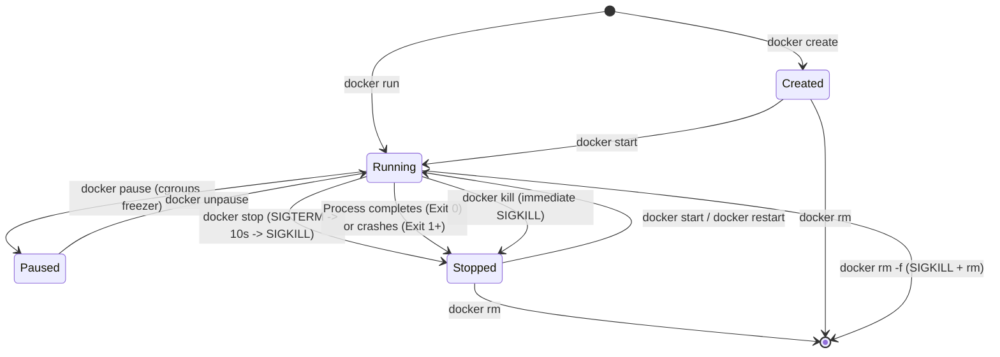
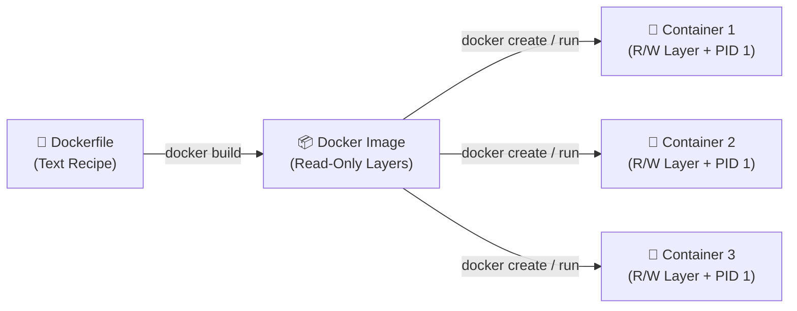
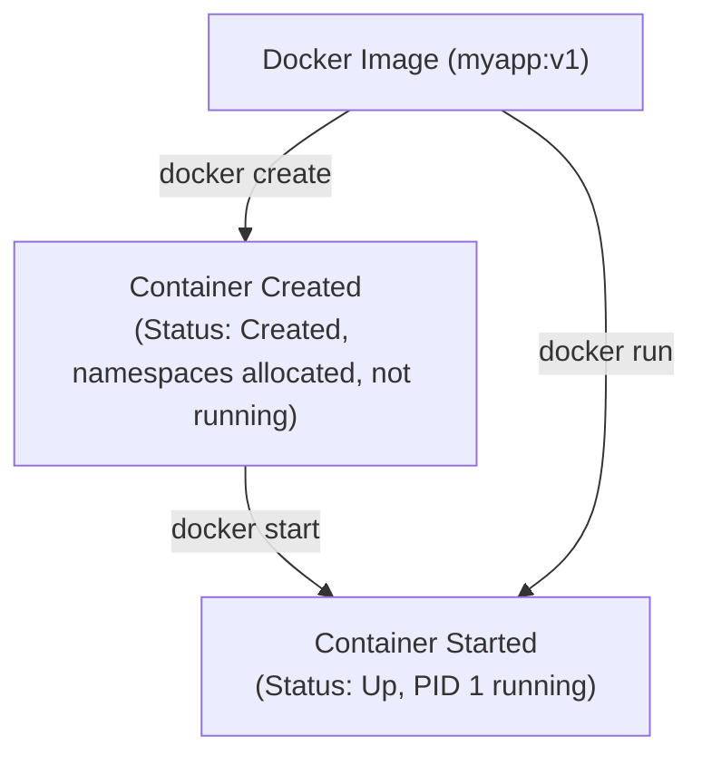

# 🐳 Docker Lifecycle: Complete Hands-On Guide

A comprehensive, production-grade guide to mastering the **Docker lifecycle**. This guide walks you through every stage—from writing a Dockerfile and building immutable images to creating, running, inspecting, troubleshooting, executing commands inside, managing, and cleaning up single and multiple containers.

---

## 📑 Table of Contents
1. [What Is the Docker Lifecycle?](#1-what-is-the-docker-lifecycle)
2. [Dockerfile, Image, and Container](#2-dockerfile-image-and-container)
3. [Build a Docker Image (Step-by-Step Hands-On)](#3-build-a-docker-image-step-by-step-hands-on)
4. [Create and Run Containers](#4-create-and-run-containers)
5. [Inspect Containers](#5-inspect-containers)
6. [View Container Logs](#6-view-container-logs)
7. [Execute Commands Inside a Container (`docker exec`)](#7-execute-commands-inside-a-container-docker-exec)
8. [Copy Files Into and Out of a Container (`docker cp`)](#8-copy-files-into-and-out-of-a-container-docker-cp)
9. [Stop, Start, Restart, and Pause Containers](#9-stop-start-restart-and-pause-containers)
10. [Remove Containers and Images (Single & Batch Operations)](#10-remove-containers-and-images-single--batch-operations)
11. [Important Docker Commands Reference](#11-important-docker-commands-reference)
12. [Day 1 Practice Tasks](#12-day-1-practice-tasks)
13. [Production Best Practices & Real-World Gotchas](#13-production-best-practices--real-world-gotchas)
14. [Real-World Troubleshooting Scenarios (Production Debugging)](#14-real-world-troubleshooting-scenarios-production-debugging)
15. [Comprehensive Interview Questions & Detailed Answers](#15-comprehensive-interview-questions--detailed-answers)

---

## 1. What Is the Docker Lifecycle?

The **Docker lifecycle** is the end-to-end journey of an application packaged inside Docker:
1. **Authoring**: Writing application code and an automated build recipe (`Dockerfile`).
2. **Building**: Packaging dependencies and code into an immutable, portable template (`Image`).
3. **Execution**: Creating, starting, pausing, and restarting isolated instances (`Containers`).
4. **Observation**: Monitoring logs, inspecting process tables, telemetry, and filesystem deltas.
5. **Teardown**: Gracefully stopping and removing containers and unused images to reclaim host resources.

### Docker Lifecycle High-Level Flow

```text
Dockerfile
    │
    ▼  (docker build)
Build Image
    │
    ▼  (docker create)
Create Container (Allocates IDs, Namespaces, Storage layer)
    │
    ▼  (docker start)  ───► OR in one step via (docker run)
Run Container (Process running as PID 1)
    │
    ▼  (docker inspect / logs / stats / top)
Inspect and View Logs
    │
    ▼  (docker stop / restart / pause)
Stop / Restart Container
    │
    ▼  (docker rm)
Remove Container (Deletes container R/W layer)
    │
    ▼  (docker rmi)
Remove Image (Optional - Frees immutable layer disk space)
```

### Docker Lifecycle State Machine

A container transitions through specific lifecycle states controlled by Docker commands and operating system signals:



---

## 2. Dockerfile, Image, and Container

Understanding the core entities and their distinctions is critical for every engineer:

| Entity | Simple Explanation | Real-World Analogy | Mutability | What It Actually Is |
|:---|:---|:---|:---|:---|
| **Dockerfile** | A text file containing sequential instructions to build an image. | The recipe book | Modifiable text | Plaintext configuration script living in version control (Git). |
| **Image** | A standalone, packaged snapshot containing the application, runtime, and libraries. | The packaged cake mix | **Immutable (Read-Only)** | An ordered stack of cryptographically hashed read-only filesystem layers. |
| **Container** | A living, isolated process instance created from an image. | The baked, served cake | **Stateful (Thin R/W Layer)** | An isolated Linux process tree running with dedicated Namespaces, cgroups, and a thin writable layer. |



> [!NOTE]
> **One Image $\rightarrow$ Multiple Containers:**  
> A single Docker image can spawn dozens of independent, isolated containers. Each container gets its own isolated network interface, hostname, process table, and a dedicated, thin **Read/Write (R/W) layer** mounted on top of the shared read-only image layers.

---

## 3. Build a Docker Image (Step-by-Step Hands-On)

### Step 1: Create a Project Directory
Open your terminal and create a dedicated practice directory:

```bash
mkdir docker-lifecycle
cd docker-lifecycle
```

### Step 2: Create Application Code (`index.html`)
Create a custom HTML file:

```html
<!DOCTYPE html>
<html lang="en">
<head>
    <meta charset="UTF-8">
    <meta name="viewport" content="width=device-width, initial-scale=1.0">
    <title>Docker Lifecycle Practice</title>
    <style>
        body {
            font-family: -apple-system, BlinkMacSystemFont, "Segoe UI", Roboto, sans-serif;
            background: #0f172a;
            color: #f8fafc;
            display: flex;
            justify-content: center;
            align-items: center;
            height: 100vh;
            margin: 0;
        }
        .card {
            background: #1e293b;
            padding: 2.5rem;
            border-radius: 12px;
            box-shadow: 0 10px 25px rgba(0,0,0,0.5);
            text-align: center;
            max-width: 480px;
        }
        h1 { color: #38bdf8; margin-bottom: 0.5rem; }
        p { color: #94a3b8; line-height: 1.6; }
        .tag {
            display: inline-block;
            background: #0284c7;
            color: white;
            padding: 0.35rem 0.85rem;
            border-radius: 9999px;
            font-weight: 600;
            font-size: 0.85rem;
        }
    </style>
</head>
<body>
    <div class="card">
        <h1>🐳 Hello Docker Lifecycle!</h1>
        <p>This application demonstrates container creation, execution, inspection, and graceful termination.</p>
        <span class="tag">Status: Running in Container</span>
    </div>
</body>
</html>
```

### Step 3: Create the `Dockerfile`
Create a file named `Dockerfile` (no extension):

```dockerfile
# Step 1: Base image - lightweight Nginx on Alpine Linux
FROM nginx:alpine

# Step 2: Set working directory inside container
WORKDIR /usr/share/nginx/html

# Step 3: Remove default Nginx welcome page
RUN rm -rf ./*

# Step 4: Copy our custom HTML page into container webroot
COPY index.html ./index.html

# Step 5: Define an environment variable
ENV ENVIRONMENT=production

# Step 6: Document that container listens on port 80
EXPOSE 80

# Step 7: Define startup process (Nginx running in foreground)
CMD ["nginx", "-g", "daemon off;"]
```

### Deep Dive into Dockerfile Instructions

| Instruction | Purpose | Key Details & Differences |
|:---|:---|:---|
| `FROM` | Defines the base image. **Must be the first non-comment instruction.** | Always specify explicit version tags (`nginx:alpine` or `node:18-alpine`) rather than `latest` in production. |
| `WORKDIR` | Sets the working directory inside the container for subsequent instructions (`RUN`, `COPY`, `CMD`). | Automatically creates the directory if it does not exist. Eliminates brittle `RUN cd /path`. |
| `COPY` | Copies files from the host build context into the image. | Preferred over `ADD` for standard local files. Transparent and simple. |
| `ADD` | Like `COPY`, but automatically unpacks local `.tar.gz` archives and can fetch remote URLs. | Use `COPY` unless you explicitly require auto-extraction of tarballs. |
| `RUN` | Executes commands **during the build process** to install packages or build source code. | Creates a new permanent layer in the image. |
| `ENV` | Sets persistent environment variables accessible during build and at runtime. | Consumed by application code (e.g. `process.env.DB_HOST` or `os.environ`). |
| `EXPOSE` | Documents the network port the container application listens on. | **Documentation only!** It does not publish the port to the host. You still need `-p` at runtime. |
| `CMD` | Provides default arguments or command when the container boots. | Easily overriden by command-line arguments: `docker run myimg custom_command`. |
| `ENTRYPOINT` | Sets the primary, fixed executable process that will always run when the container starts. | Difficult to override. Arguments passed to `docker run` are appended as parameters to `ENTRYPOINT`. |

---

### Step 4: Build the Image

```bash
docker build -t myapp:v1 .
```

#### Command Breakdown:
- `docker build`: Invokes the Docker Engine build system.
- `-t myapp:v1`: Tags the image with `name:tag` (`myapp` is repository name, `v1` is version tag).
- `.`: Sets the **Build Context** to the current directory. Docker sends files in this path to the Docker daemon.

#### Expected Output:
```text
[+] Building 1.2s (8/8) FINISHED                                docker:desktop-linux
 => [internal] load build definition from Dockerfile                            0.0s
 => => transferring dockerfile: 312B                                            0.0s
 => [internal] load metadata for docker.io/library/nginx:alpine                 0.8s
 => [1/4] FROM docker.io/library/nginx:alpine                                   0.0s
 => [2/4] WORKDIR /usr/share/nginx/html                                         0.0s
 => [3/4] RUN rm -rf ./*                                                        0.2s
 => [4/4] COPY index.html ./index.html                                          0.0s
 => exporting to image                                                          0.1s
 => => exporting layers                                                         0.1s
 => => naming to docker.io/library/myapp:v1                                     0.0s
```

---

### Step 5: Inspect and Manage Images

#### 1. List Images (`docker images`)
```bash
docker images
```
*Expected Output:*
```text
REPOSITORY   TAG       IMAGE ID       CREATED         SIZE
myapp        v1        7e45b128c9b3   1 minute ago    41.2MB
nginx        alpine    91b4b3c0e123   3 days ago      41.2MB
```

#### 2. Inspect Image Details (`docker image inspect`)
```bash
docker image inspect myapp:v1
```
*Extract specific fields using Go template formatting:*
```bash
# Check architecture and OS:
docker image inspect --format '{{.Architecture}} - {{.Os}}' myapp:v1
# Output: arm64 - linux (or amd64 - linux)

# Check exposed ports:
docker image inspect --format '{{json .Config.ExposedPorts}}' myapp:v1
# Output: {"80/tcp":{}}
```

#### 3. View Image History (`docker history`)
Shows each layer, its size, and the build command that created it:
```bash
docker history myapp:v1
```
*Expected Output:*
```text
IMAGE          CREATED         CREATED BY                                      SIZE      COMMENT
7e45b128c9b3   2 minutes ago   CMD ["nginx" "-g" "daemon off;"]                0B        buildkit.dockerfile.v0
<missing>      2 minutes ago   EXPOSE map[80/tcp:{}]                           0B        buildkit.dockerfile.v0
<missing>      2 minutes ago   ENV ENVIRONMENT=production                      0B        buildkit.dockerfile.v0
<missing>      2 minutes ago   COPY index.html ./index.html                    342B      buildkit.dockerfile.v0
<missing>      2 minutes ago   RUN /bin/sh -c rm -rf ./*                       0B        buildkit.dockerfile.v0
<missing>      2 minutes ago   WORKDIR /usr/share/nginx/html                   0B        buildkit.dockerfile.v0
```

#### 4. Tag an Image (`docker tag`)
Tags create aliases pointing to the same underlying Image ID without copying data:
```bash
docker tag myapp:v1 myapp:v2
docker tag myapp:v1 myapp:latest
```

#### 5. Remove an Image (`docker rmi`)
```bash
docker rmi myapp:v2
```
> [!WARNING]
> You cannot remove an image if a container (even a stopped container) was created from it. Stop and remove the container first!

---

## 4. Create and Run Containers

Understanding the separation between creating, starting, and running containers is fundamental:

$$\text{docker run} = \text{docker create} + \text{docker start} \;(+\; \text{docker attach \text{ if foreground}})$$



---

### Step 1: Create a Container (`docker create`)
Creates the container's isolated filesystem layer and configuration without executing PID 1:

```bash
docker create --name mycontainer myapp:v1
```
*Docker returns the full 64-character Container ID.*

Check its status:
```bash
docker ps -a --filter "name=mycontainer"
```
*Notice that status is `Created`:*
```text
CONTAINER ID   IMAGE      COMMAND                  CREATED         STATUS    PORTS     NAMES
a8f10b2c34d5   myapp:v1   "/docker-entrypoint.…"   5 seconds ago   Created             mycontainer
```

---

### Step 2: Start the Container (`docker start`)
Boots the container process (PID 1) into active execution:

```bash
docker start mycontainer
```

Check status again:
```bash
docker ps --filter "name=mycontainer"
```
*Notice status has transitioned to `Up`:*
```text
CONTAINER ID   IMAGE      COMMAND                  CREATED          STATUS         PORTS     NAMES
a8f10b2c34d5   myapp:v1   "/docker-entrypoint.…"   30 seconds ago   Up 3 seconds             mycontainer
```

---

### Step 3: Create and Start a Container in One Step (`docker run`)
In everyday operations, `docker run` is the standard command:

```bash
docker run -d --name myweb -p 8081:80 myapp:v1
```

#### Flag Explanation:
- `-d` (**Detached Mode**): Runs the container in the background as a daemon process and frees up your terminal.
- `--name myweb`: Assigns a descriptive human-readable name instead of an auto-generated random string (e.g. `naughty_morse`).
- `-p 8081:80` (**Port Publishing**): Maps host port `8081` to container internal port `80`.
- `myapp:v1`: The image name and tag to instantiate.

#### Access the Web Application
Open your web browser and visit:
```text
http://localhost:8081
```
Or test via curl in your terminal:
```bash
curl -i http://localhost:8081
```

---

### Running Interactive Containers (`-it`)
When troubleshooting or working with base operating system images (like Ubuntu or Alpine):

```bash
docker run -it --name myubuntu ubuntu:latest bash
```

- `-i` (`--interactive`): Keeps standard input (`STDIN`) open so you can type commands.
- `-t` (`--tty`): Allocates a pseudo-TTY terminal emulator for cursor control, color formatting, and line editing.
- Type `exit` to terminate the shell and container.

---

### Running Multiple Containers at a Time (Batch Operations)
Because containers share the host kernel and have dedicated network namespaces, you can spin up multiple containers from the same image simultaneously:

#### Manual Multi-Container Execution:
```bash
docker run -d --name myweb-1 -p 8081:80 myapp:v1
docker run -d --name myweb-2 -p 8082:80 myapp:v1
docker run -d --name myweb-3 -p 8083:80 myapp:v1
```

#### Automated Shell Loop:
```bash
# Launch 5 containers from port 8091 to 8095 in 2 seconds
for port in {8091..8095}; do
  docker run -d --name "worker-web-${port}" -p "${port}:80" myapp:v1
done
```

Verify all are running:
```bash
docker ps --filter "name=worker-web"
```

---

## 5. Inspect Containers

Inspection commands provide visibility into container metadata, networking, resource utilization, and internal filesystem states.

| Command | Purpose | When to Use It |
|:---|:---|:---|
| `docker ps` | Shows active, running containers. | Health checks and verifying published ports. |
| `docker ps -a` | Shows **all** containers (running, stopped, crashed). | Finding containers that crashed or exited prematurely. |
| `docker inspect myweb` | Outputs complete JSON configuration and state. | Diagnosing IP addresses, mounts, environment variables, restart counts. |
| `docker stats myweb` | Displays live telemetry stream of CPU, memory, and network I/O. | Diagnosing memory leaks and CPU spikes. |
| `docker top myweb` | Displays running processes inside the container. | Checking if worker processes or zombies are active. |
| `docker port myweb` | Displays active host-to-container port mappings. | Verifying external traffic routing. |
| `docker diff myweb` | Shows filesystem changes in the container's writable layer. | Auditing modified, added, or deleted files. |

---

### Practical Inspection Examples

#### 1. Checking Status via Go Template:
```bash
docker inspect --format '{{.State.Status}}' myweb
# Output: running
```

#### 2. Inspecting the Container's Internal IP Address:
```bash
docker inspect --format '{{range .NetworkSettings.Networks}}{{.IPAddress}}{{end}}' myweb
# Output: 172.17.0.2
```

#### 3. Inspecting Process ID (Host PID):
```bash
docker inspect --format '{{.State.Pid}}' myweb
# Output: 4512
```

#### 4. Checking Resource Usage Without Continuous Streaming:
```bash
docker stats --no-stream myweb
```
*Expected Output:*
```text
CONTAINER ID   NAME    CPU %     MEM USAGE / LIMIT     MEM %     NET I/O           BLOCK I/O   PIDS
4a7c8e9f1234   myweb   0.01%     3.98MiB / 7.67GiB     0.05%     1.18kB / 2.12kB   0B / 0B     3
```

#### 5. Inspecting Processes Running Inside the Container:
```bash
docker top myweb
```
*Expected Output:*
```text
UID     PID     PPID    C   STIME   TTY   TIME       CMD
root    4512    4489    0   10:30   ?     00:00:00   nginx: master process nginx -g daemon off;
101     4560    4512    0   10:30   ?     00:00:00   nginx: worker process
101     4561    4512    0   10:30   ?     00:00:00   nginx: worker process
```

#### 6. Inspecting Filesystem Changes (`docker diff`):
```bash
docker diff myweb
```
*Prefix Legend:*
- `A`: File or directory **Added**.
- `C`: File or directory **Changed** (modified).
- `D`: File or directory **Deleted**.

```text
C /var
C /var/cache
C /var/cache/nginx
A /var/cache/nginx/client_temp
C /run
A /run/nginx.pid
```

---

## 6. View Container Logs

Docker automatically captures everything written by the container application to **standard output (`stdout`)** and **standard error (`stderr`)**.

```bash
# View all historical logs accumulated since container start
docker logs myweb

# Follow / Stream logs in real time (similar to tail -f)
docker logs -f myweb

# View only the last 50 lines of logs
docker logs --tail 50 myweb

# View logs emitted in the last 10 minutes
docker logs --since 10m myweb

# Display precise timestamps alongside log lines
docker logs -t myweb

# Combine flags: Follow last 20 lines with timestamps
docker logs -f -t --tail 20 myweb
```

> [!TIP]
> **Press `Ctrl + C` to stop following logs.**  
> Streaming logs with `-f` attaches your terminal only to the logging output stream. Pressing `Ctrl + C` disconnects your terminal stream; **it does NOT stop the container!**

### Crucial Production Note on Container Logging
> [!IMPORTANT]
> If your application writes logs exclusively to internal flat files (such as `/var/log/app.log`) rather than `stdout`/`stderr`, `docker logs` will output nothing!  
> For containers, always configure your logger (Log4j, Winston, Python logging) to log to standard output, or create symlinks to `/dev/stdout` and `/dev/stderr`.

---

## 7. Execute Commands Inside a Container (`docker exec`)

`docker exec` allows you to launch an auxiliary process **inside an already running container**. It is the primary tool for live debugging, inspecting environment variables, running database migrations, and testing network connectivity.

### `docker exec` vs. `docker run` vs. `docker attach`

| Command | Action | Primary Purpose |
|:---|:---|:---|
| `docker run` | Creates and starts a **brand-new container** from an image. | Launching an application or service. |
| `docker exec` | Spawns a **new child process** inside an *existing, running* container. | Live debugging, troubleshooting, running one-off tasks. |
| `docker attach` | Connects your terminal directly to the container's **existing PID 1 process**. | Viewing active console. **Warning:** `Ctrl + C` stops the whole container! |

---

### Opening an Interactive Shell Session

```bash
# For minimal Alpine Linux images (uses Bourne Shell):
docker exec -it myweb sh

# For Ubuntu/Debian/CentOS images (with Bash):
docker exec -it myweb bash
```

> [!WARNING]
> **Why does `bash` fail on Alpine Linux?**  
> Alpine Linux is built for minimal size (~5MB) and uses BusyBox `sh` instead of GNU `bash`. Running `docker exec -it myweb bash` on an Alpine container results in:  
> `OCI runtime exec failed: exec: "bash": executable file not found in $PATH`.  
> Always use `sh` for Alpine images!

#### Shell Navigation Inside the Container:
```sh
/usr/share/nginx/html # pwd
/usr/share/nginx/html # ls -la /
/usr/share/nginx/html # cat index.html
/usr/share/nginx/html # exit
```
Typing `exit` terminates only the auxiliary shell session. The main web server (Nginx PID 1) remains running.

---

### Executing Single Non-Interactive Commands
You can execute single commands directly without entering an interactive shell:

```bash
# Print hostname (returns container ID)
docker exec myweb hostname

# Check operating system release info
docker exec myweb cat /etc/os-release

# Inspect active environment variables
docker exec myweb env

# Verify disk space inside container
docker exec myweb df -h
```

---

## 8. Copy Files Into and Out of a Container (`docker cp`)

`docker cp` transfers files and directories bidirectionally between the host machine and a container (works whether the container is running or stopped).

### 1. Copy File from Host into Container
```bash
# Syntax: docker cp <host-path> <container>:<container-path>
docker cp ./index.html myweb:/usr/share/nginx/html/index.html
```

### 2. Copy File from Container to Host
```bash
# Syntax: docker cp <container>:<container-path> <host-path>
docker cp myweb:/etc/os-release ./os-release.txt
```

### 3. Verify Changes in Container Writable Layer
```bash
docker diff myweb
```

### The Copy-on-Write (CoW) Mechanism
- Image layers are **immutable (read-only)**.
- When you run a container, Docker stacks a thin **writable layer** on top.
- When you edit an existing image file, Docker uses **Copy-on-Write (CoW)**: the file is copied from the read-only layer into the writable layer, and changes are applied to that copy.
- The underlying image remains untouched.

> [!WARNING]
> **Data Loss Risk with Container Removal:**  
> When you delete a container (`docker rm myweb`), its thin writable layer is permanently destroyed. Any files created or modified inside that container are permanently lost!  
> For stateful workloads (databases, user uploads, application logs), **always use Docker Volumes or Bind Mounts**.

---

## 9. Stop, Start, Restart, and Pause Containers

### 1. Stop a Container Gracefully (`docker stop`)
```bash
docker stop myweb
```
- Sends a `SIGTERM` signal to the container's PID 1 process.
- The application is given a default **10-second grace period** to close database connections, finish processing in-flight HTTP requests, and flush disk buffers.
- If the application fails to exit within 10 seconds, Docker sends `SIGKILL` to force termination.

### 2. Stop a Container Immediately (`docker kill`)
```bash
docker kill myweb
```
- Sends an immediate `SIGKILL` signal (no grace period). Process terminates instantly.

### 3. Start a Stopped Container (`docker start`)
```bash
docker start myweb
```
- Restarts the container. All data written to the thin writable layer remains intact!

### 4. Restart a Container (`docker restart`)
```bash
docker restart myweb
```
- Issues a `docker stop` followed by a `docker start`.

### 5. Pause and Unpause Container Execution (`docker pause` / `docker unpause`)
```bash
# Freeze all processes in the container (consumes 0% CPU)
docker pause myweb

# Resume execution instantly
docker unpause myweb
```
- Uses the Linux kernel `cgroups freezer` subsystem to suspend container processes without stopping or restarting them.

### 6. Rename a Container (`docker rename`)
```bash
docker rename myweb myweb-production
```
- Renames the container. Subsequent commands must use `myweb-production`.

---

## 10. Remove Containers and Images (Single & Batch Operations)

### Removing Single Containers Safely
```bash
# 1. Stop the container first
docker stop myweb-production

# 2. Remove the container
docker rm myweb-production
```

### Force Removing a Running Container
```bash
# Sends SIGKILL and deletes container in one command
docker rm -f myweb-production
```

### Removing Images
```bash
docker rmi myapp:v1
```

---

### Batch Operations: Managing Multiple Containers (Essential DevOps Recipes)

In real-world environments, managing containers one by one is impractical. Here are standard multi-container commands:

#### 1. Stop Multiple Specific Containers:
```bash
docker stop web1 web2 web3
```

#### 2. Stop ALL Running Containers at Once:
```bash
docker stop $(docker ps -q)
```
*(Explanation: `docker ps -q` returns only the IDs of running containers; `$(...)` passes those IDs into `docker stop`).*

#### 3. Remove ALL Stopped Containers:
```bash
docker rm $(docker ps -a -q -f status=exited)
```

#### 4. Force Remove ALL Containers on the System:
```bash
docker rm -f $(docker ps -aq)
```
> [!CAUTION]
> This command terminates and deletes **every container** (running and stopped) on your system. Use with extreme care!

#### 5. Clean Up Dangling Images:
```bash
docker rmi $(docker images -f "dangling=true" -q)
```

#### 6. Safe Automated Garbage Collection (`prune`):
```bash
# Remove all stopped containers
docker container prune -f

# Remove all unused networks
docker network prune -f

# Deep cleanup: removes all stopped containers, unused networks, and dangling images
docker system prune -f

# Total nuclear cleanup: also removes unused images and unused volumes
docker system prune -a --volumes -f
```

---

## 11. Important Docker Commands Reference

| Command | Category | Purpose | Modifies Host / Resource State? |
|:---|:---|:---|:---|
| `docker build -t <name:tag> .` | Build | Compiles Dockerfile and context into an image. | **Yes** (Creates Image) |
| `docker images` | Image | Lists all locally stored images. | No |
| `docker image inspect <image>` | Image | Returns full JSON metadata of an image. | No |
| `docker history <image>` | Image | Displays layer build history and command steps. | No |
| `docker tag <src> <target>` | Image | Assigns an alias tag to an image ID. | **Yes** (Adds Tag) |
| `docker rmi <image>` | Image | Deletes an image from local store. | **Yes** (Deletes Image) |
| `docker create --name <n> ` | Container | Prepares container filesystem without starting process. | **Yes** (Creates Container) |
| `docker start <container>` | Container | Starts an existing created or stopped container. | **Yes** (Starts Process) |
| `docker run -d -p <H:C> ` | Container | Creates and starts container in background. | **Yes** (Creates & Starts) |
| `docker ps` | Inspect | Lists active running containers. | No |
| `docker ps -a` | Inspect | Lists all containers across all states. | No |
| `docker inspect <container>` | Inspect | Detailed JSON metadata of container. | No |
| `docker stats` | Monitor | Live CPU, memory, and network telemetry. | No |
| `docker top <container>` | Monitor | Shows host PIDs running inside container. | No |
| `docker port <container>` | Network | Shows public-to-private port mappings. | No |
| `docker logs -f <container>` | Debug | Streams stdout and stderr logs. | No |
| `docker exec -it <c> sh` | Debug | Spawns interactive shell inside running container. | **Yes** (Spawns Process) |
| `docker cp <src> <dst>` | Storage | Copies files between host and container. | **Yes** (Modifies Layer) |
| `docker diff <container>` | Storage | Displays modified files in writable layer. | No |
| `docker stop <container>` | Manage | Gracefully terminates container (`SIGTERM`). | **Yes** (Stops Process) |
| `docker kill <container>` | Manage | Abruptly terminates container (`SIGKILL`). | **Yes** (Kills Process) |
| `docker restart <container>`| Manage | Restarts container (`stop` then `start`). | **Yes** |
| `docker pause <container>` | Manage | Freezes container execution (`cgroups freezer`).| **Yes** |
| `docker unpause <container>` | Manage | Unfreezes paused container. | **Yes** |
| `docker rm <container>` | Cleanup | Deletes stopped container. | **Yes** (Deletes Layer) |
| `docker rm -f <container>` | Cleanup | Kills and deletes running container. | **Yes** (Deletes Layer) |
| `docker container prune` | Cleanup | Deletes all stopped containers. | **Yes** (Bulk Cleanup) |

---

## 12. Day 1 Practice Tasks

Complete these tasks sequentially to build muscle memory:

- [ ] Create a dedicated project directory: `mkdir docker-lifecycle && cd docker-lifecycle`.
- [ ] Create an `index.html` file and write a clean `Dockerfile`.
- [ ] Build the custom image using `docker build -t myapp:v1 .`.
- [ ] List your image with `docker images` and inspect layers with `docker history myapp:v1`.
- [ ] Create a container without starting it using `docker create --name test-box myapp:v1`.
- [ ] Verify its status is `Created` via `docker ps -a`.
- [ ] Start the container using `docker start test-box`.
- [ ] Create and run a web container in detached mode with port mapping: `docker run -d --name myweb -p 8081:80 myapp:v1`.
- [ ] Open `http://localhost:8081` in your browser to verify access.
- [ ] Inspect container status with `docker inspect --format '{{.State.Status}}' myweb`.
- [ ] Monitor resource usage with `docker stats --no-stream`.
- [ ] Stream container logs with `docker logs -f myweb`.
- [ ] Launch an interactive shell with `docker exec -it myweb sh` and explore files.
- [ ] Copy a file into the container with `docker cp` and verify changes with `docker diff myweb`.
- [ ] Stop, restart, pause, and unpause the container.
- [ ] Launch 3 containers on different ports (`8081`, `8082`, `8083`) simultaneously.
- [ ] Stop and clean up all containers using batch commands (`docker rm -f $(docker ps -aq)`).
- [ ] Remove the practice image using `docker rmi myapp:v1`.

---

## 13. Production Best Practices & Real-World Gotchas

### 1. Never Use `:latest` in Production
- The `latest` tag is mutable and changes whenever a newer image is pushed.
- Two servers deployed at different times using `myapp:latest` could run completely different versions of your code!
- **Best Practice:** Pin explicit, immutable semantic tags (e.g., `myapp:1.4.2`) or commit SHAs (`myapp:sha-7a8f1b2`).

### 2. Never Run Containers as `root`
- By default, containers run as `root` (UID 0). If a container breakout vulnerability occurs, the attacker has root privileges on the host.
- **Best Practice:** Add a non-privileged user in your Dockerfile:
  ```dockerfile
  RUN adduser -D -u 1000 appuser
  USER appuser
  ```

### 3. Handle `SIGTERM` Properly for Graceful Shutdowns
- In orchestration platforms like Kubernetes or Docker Swarm, rolling updates send `SIGTERM` to containers.
- If your application ignores `SIGTERM`, active customer HTTP requests or transactions are abruptly severed when `SIGKILL` arrives 10 seconds later.
- Ensure your Node.js, Go, or Python application intercepts `SIGTERM` and closes connections gracefully.

### 4. Solve the PID 1 Zombie Reaping Problem
- In Linux, process ID 1 is responsible for reaping orphan child processes.
- Most standard application binaries (like Node or Python) are not designed to act as init systems (`PID 1`) and fail to reap dead child processes, causing memory leaks and zombie accumulation.
- **Best Practice:** Use Docker's built-in init system by adding the `--init` flag to `docker run`:
  ```bash
  docker run --init -d myapp:v1
  ```

### 5. Always Use `.dockerignore`
- Without a `.dockerignore` file, `docker build` sends massive unnecessary files (e.g. `node_modules`, `.git`, temporary log files, `.env` files with secret keys) to the Docker daemon build context.
- Always create a `.dockerignore` file containing:
  ```text
  .git
  node_modules
  *.log
  .env
  ```

---

## 14. Real-World Troubleshooting Scenarios (Production Debugging)

### Scenario 1: Container Exits Immediately (`Exited (0)`)
**Symptom:**  
You run `docker run -d --name test ubuntu:latest`. When you run `docker ps`, the container is not there. Running `docker ps -a` shows:  
`STATUS: Exited (0) 2 seconds ago`.

**Root Cause:**  
A container runs **only as long as its foreground root process (PID 1) is active**. The default command for the `ubuntu` image is `bash`. In detached mode without an interactive TTY, `bash` detects no input stream, completes immediately, and exits cleanly with code 0.

**Fix:**  
Ensure the process stays in the foreground, or supply an interactive flag:
```bash
docker run -it -d --name test ubuntu:latest bash
```

---

### Scenario 2: Container Crashes with `Exited (137)` (OOMKilled)
**Symptom:**  
A container stops abruptly in production. `docker ps -a` shows:  
`STATUS: Exited (137)`.

**Root Cause:**  
Exit code `137` is calculated as $128 + 9$ (`SIGKILL`). The Linux kernel **Out-Of-Memory (OOM) Killer** terminated the container process because it exceeded the configured memory limit.

**Verification:**  
```bash
docker inspect --format 'OOMKilled: {{.State.OOMKilled}} | ExitCode: {{.State.ExitCode}}' myapp
# Output: OOMKilled: true | ExitCode: 137
```

**Fix:**  
Increase the memory limit via `-m` (e.g., `-m 1g`) or profile your application for memory leaks.

---

### Scenario 3: Port Collision (`bind: address already in use`)
**Symptom:**  
```text
Error response from daemon: driver failed programming external connectivity on endpoint myweb: 
Bind for 0.0.0.0:8081 failed: port is already allocated.
```

**Root Cause:**  
Another container or local host application is already listening on host port `8081`.

**Diagnostic Commands:**  
```bash
# Check if another Docker container is using the port
docker ps --filter "publish=8081"

# On macOS / Linux, check host process binding
lsof -i :8081
```

**Fix:**  
Stop the conflicting process or choose an unused host port:
```bash
docker run -d -p 8082:80 myapp:v1
```

---

### Scenario 4: Alpine Shell Error (`executable file not found in $PATH`)
**Symptom:**  
```bash
$ docker exec -it myalpine bash
OCI runtime exec failed: exec: "bash": executable file not found in $PATH: unknown
```

**Root Cause:**  
Minimalist images like Alpine Linux or Distroless do not include GNU `bash`.

**Fix:**  
Use the standard POSIX shell `sh`:
```bash
docker exec -it myalpine sh
```

---

### Scenario 5: Disk Full (`no space left on device`)
**Symptom:**  
Builds fail with `write /var/lib/docker/tmp/...: no space left on device`.

**Root Cause:**  
Accumulation of stopped containers, unused volumes, and dangling build cache layers.

**Diagnostic Command:**  
```bash
docker system df
```
*Expected Output:*
```text
TYPE            TOTAL     ACTIVE    SIZE      RECLAIMABLE
Images          18        3         4.82GB    3.91GB (81%)
Containers      12        2         184MB     152MB (82%)
Local Volumes   6         1         2.15GB    1.89GB (87%)
Build Cache     42        0         6.24GB    6.24GB (100%)
```

**Fix:**  
Perform safe automated garbage collection:
```bash
docker system prune -a --volumes -f
```

---

## 15. Comprehensive Interview Questions & Detailed Answers

### Q1: What is the exact difference between `CMD` and `ENTRYPOINT` in a Dockerfile?
**Answer:**  
- `ENTRYPOINT` defines the **fixed command/executable** that will always run when the container starts (e.g., `ENTRYPOINT ["nginx"]`). It is not easily overridden from the command line.
- `CMD` defines **default arguments** passed to the `ENTRYPOINT` (or the default command if `ENTRYPOINT` is omitted).
- When a user runs `docker run myimage arg1 arg2`, any parameters passed on the CLI override `CMD`, but they are appended to `ENTRYPOINT`.
- **Best Practice Combination:**
  ```dockerfile
  ENTRYPOINT ["python", "app.py"]
  CMD ["--port", "8080"]
  ```
  Running `docker run myimage` executes `python app.py --port 8080`.  
  Running `docker run myimage --port 9090` executes `python app.py --port 9090`.

---

### Q2: What actually happens under the hood when you run `docker run`?
**Answer:**  
When you execute `docker run`:
1. The **Docker Client** translates the command into REST API calls (`POST /containers/create` and `POST /containers/{id}/start`).
2. The **Docker Daemon (`dockerd`)** checks local storage for the specified image. If missing, it pulls the manifest and layers from the Docker Registry.
3. The daemon delegates to **`containerd`**, which allocates storage using OverlayFS snapshots.
4. **`runc`** interacts with the Linux kernel to assemble isolated **Namespaces** (PID, NET, MNT, IPC, UTS, USER) and **cgroups** quotas.
5. A virtual Ethernet (`veth`) pair connects the container's network namespace to the `docker0` bridge, and `iptables` NAT rules are written for published ports.
6. `runc` launches the root process (PID 1), hands process supervision to `containerd-shim`, and exits.

---

### Q3: What is the difference between `docker stop` and `docker kill`?
**Answer:**  
- `docker stop` performs a **graceful termination**. It sends `SIGTERM` to the container process, giving it a 10-second grace period to finish active transactions, flush disk buffers, and close network sockets. If the process does not terminate within the timeout, Docker sends `SIGKILL`.
- `docker kill` sends an immediate, uncatchable `SIGKILL` (or an explicitly requested signal like `SIGHUP`), abruptly terminating the container with zero cleanup time.

---

### Q4: How does the container writable layer work, and what is Copy-on-Write (CoW)?
**Answer:**  
A Docker image consists of immutable, read-only layers stacked via a union filesystem (OverlayFS). When a container is created, Docker places a thin, mutable **Read/Write (R/W) layer** on top.
When a process inside the container modifies an existing file:
1. Docker copies the file up from the underlying read-only image layer into the writable layer (Copy-on-Write).
2. The modification is written to this copy in the writable layer.
3. The underlying image layer remains unmodified and shared across all other containers.
4. When the container is deleted (`docker rm`), its writable layer is deleted, destroying all modifications made during its lifecycle.

---

### Q5: What is the difference between `docker exec` and `docker attach`?
**Answer:**  
- `docker exec` spawns a **brand-new child process** inside an already running container namespace. Exiting this shell does not affect the container.
- `docker attach` binds your terminal directly to the container's **existing root process (PID 1)** standard I/O streams. Pressing `Ctrl + C` sends `SIGINT` to PID 1, terminating the entire container.

---

### Q6: Can a stopped container be restarted? What happens to its files?
**Answer:**  
Yes. A container stopped with `docker stop` retains its configuration, network settings, and all files in its thin writable layer. Running `docker start <container>` boots the container process again with all previous modifications completely intact. Files are only destroyed when the container is explicitly deleted using `docker rm`.

---

### Q7: What is the difference between a dangling image and an unused image?
**Answer:**  
- A **dangling image** is an intermediate layer that is no longer tagged by any repository. It appears as `<none>:<none>` in `docker images` and usually occurs when an image is rebuilt with the same name and tag.
- An **unused image** is a fully tagged, valid image that is simply not referenced by any running or stopped container on the host.
- Clean dangling images with: `docker image prune`.
- Clean all unused images with: `docker image prune -a`.

---

### Q8: How does Docker know when a container has finished executing?
**Answer:**  
Docker monitors the container's root process (**PID 1**). As long as PID 1 is executing, the container status is `Up (Running)`. The moment PID 1 exits (either successfully with exit code 0 or due to a crash with a non-zero exit code), the Linux kernel emits a `SIGCHLD` signal to `containerd-shim`. The shim captures the exit code and notifies the Docker daemon, which updates the container status to `Exited (<exit_code>)`.

---

## 📌 Summary: The Golden Lifecycle Sequence

Remember the fundamental sequence:

$$\text{Dockerfile} \longrightarrow \text{Image} \longrightarrow \text{Container} \longrightarrow \text{Inspect} \longrightarrow \text{Troubleshoot} \longrightarrow \text{Stop} \longrightarrow \text{Remove}$$

Mastering this lifecycle gives you complete control over building, running, debugging, and scaling containerized applications in production environments.
